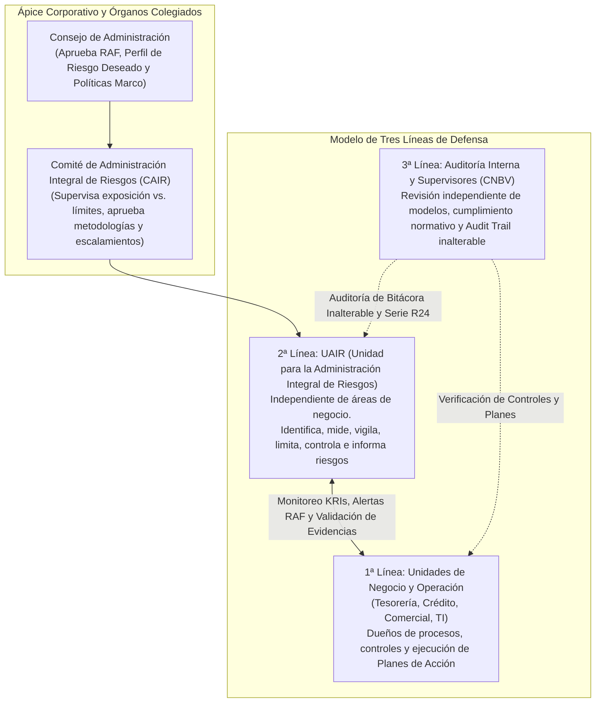

# Contexto General y Base de Conocimiento Integral: Herramienta Inteligente de Gestión de Riesgos Relevantes y Emergentes — Banco Ve por Más (B×+)

> [!IMPORTANT]
> **Propósito del Documento:** Este documento constituye la **Base de Conocimiento Maestra (Single Source of Truth)** para el diseño, arquitectura, modelado de datos, parametrización matemática y auditoría de la **Herramienta Inteligente de Gestión de Riesgos Relevantes y Emergentes para Banco Ve por Más (Banco B×+)** en su Primera Fase (100% enfocada en la operación bancaria bajo regulación **CNBV / CUB, Banxico, SHCP, Basilea III y NIF C-16**). Consolida el marco normativo bancario mexicano, las metodologías cuantitativas y cualitativas de referencia (Start Consulting, SMNYL, Rimac), la problemática operativa actual de Banco B×+ y el sistema de diseño institucional (*Taste Index B×+*).

---

## 1. Contexto Institucional y Problemática Operativa Actual en B×+

### 1.1 Perfil Estratégico de Grupo Financiero Ve por Más (B×+)
**Banco Ve por Más (B×+)** es una institución de banca múltiple mexicana cuya estrategia comercial presenta una alta especialización y concentración en los sectores **empresarial, pequeñas y medianas empresas (PyME), agropecuario (Agronegocios), arrendamiento, seguros (Seguros B×+) e inversiones/tesorería**. Esta composición de balance implica una exposición multidimensional tanto a riesgos financieros discrecionales (crédito con alta sensibilidad sectorial/climática, mercado y tasas TIIE/cambiario, liquidez) como a riesgos no discrecionales (operacional, tecnológico, legal) y riesgos emergentes (ciberseguridad en SPEI/canales digitales y riesgos climáticos/ASG en la cartera agropecuaria y PyME).

### 1.2 Diagnóstico de Puntos de Dolor (Pain Points) en la Operación Actual
De acuerdo con el levantamiento estratégico realizado por *Start Consulting* (`20261013_Bx+ Propuesta Estratégica de Gestión de Riesgos Emergentes y Operativos_v1.0.pdf`), la Dirección de Riesgos Relevantes y Emergentes de B×+ enfrenta un cuello de botella operacional caracterizado por cuatro grandes fricciones:

1. **Volumen vs. Priorización Ejecutiva (Saturación Analítica):**
   - Las matrices de riesgo operativas alojadas en hojas de cálculo superan los **80+ riesgos mapeados por área**, generando saturación por volumen.
   - Se carece de un algoritmo automatizado y objetivo que filtre el "ruido operativo" y extraiga dinámicamente el **Top 5 a 7 de riesgos verdaderamente críticos** que el Comité de Administración Integral de Riesgos (CAIR) y la Alta Dirección deben vigilar.
2. **Fricción de Herramientas Legadas y Dependencia de Excel:**
   - Plataformas GRC legadas (como *RSA Archer*) han caído en desuso operativo debido a su excesiva rigidez, complejidad de captura y fricción en la experiencia de usuario.
   - Esto ha perpetuado la dependencia de **libros de Excel aislados**, consumiendo el tiempo de los analistas de la UAIR y de los dueños de procesos en tareas manuales de consolidación, validación de fórmulas y persecución de evidencias por correo electrónico, dejando nulo espacio para la analítica prospectiva o el uso de Inteligencia Artificial.
3. **Desconexión Macro-Micro (Entorno Externo vs. Balance Interno):**
   - Existe una marcada dificultad operativa para traducir reportes globales de riesgos emergentes (p. ej. *World Economic Forum - WEF*, reportes de estabilidad financiera de *Banxico*, alertas de ciberseguridad o disposiciones de la *CNBV/CNSF*) en impactos directos y cuantificables sobre líneas de negocio específicas (ej. Mesa de Tesorería, Derivados, Suscripción, Cartera Agropecuaria) y en Indicadores Clave de Riesgo (*KRIs*) accionables.
4. **Brecha de Adopción Segura de Inteligencia Artificial (Riesgo de Alucinación):**
   - Incertidumbre técnica sobre qué modelos de IA utilizar y cómo conectar de forma segura datos financieros internos (balances contables, portafolios de inversión, matrices de procesos) con fuentes regulatorias externas mediante arquitecturas **RAG (Retrieval-Augmented Generation)** para obtener simulaciones de estrés y recomendaciones de control sin alucinaciones ni fugas de información confidencial.

---

## 2. Marco de Gobernanza y Fundamentos Regulatorios en el Sistema Financiero Mexicano

La Administración Integral de Riesgos (AIR) en México se rige por las **Disposiciones de Carácter General Aplicables a las Instituciones de Crédito (Circular Única de Bancos - CUB)** emitidas por la **CNBV**, en conjunto con las circulares del **Banco de México (Banxico)**, la **SHCP** y las Normas de Información Financiera (**NIF C-16** del CINIF).

### 2.1 Estructura de Gobernanza y Tres Líneas de Defensa
La arquitectura de permisos (RBAC), flujos de aprobación y bitácoras de la plataforma debe reflejar estrictamente la separación de funciones mandatada por la CUB (Artículos 65 al 76):

- **Independencia Reglamentaria:** La plataforma debe impedir por diseño (mediante reglas RBAC) que las unidades de originación o negocio modifiquen parámetros metodológicos, ponderadores de severidad o umbrales del Marco de Apetito al Riesgo (RAF), cuya administración es facultad exclusiva de la **UAIR** con aprobación del **CAIR**.
- **Separación en Procesos Crediticios y Operativos:** En el modelado visual de diagramas de flujo, el sistema debe exigir la segregación entre las funciones de **Promoción, Evaluación, Aprobación, Instrumentación/Operación y Control**.

### 2.2 El Marco de Apetito al Riesgo (RAF — Artículo 88 de la CUB)
El **Risk Appetite Framework (RAF)** es el eje rector sobre el cual se semaforiza toda la plataforma. Debe articularse matemáticamente en cuatro niveles concéntricos por factor de riesgo, línea de negocio, sector económico, zona geográfica y grupo de riesgo común:

| Nivel del RAF | Definición Regulatoria y Funcional | Acción Automatizada en la Plataforma B×+ |
| :--- | :--- | :--- |
| **1. Capacidad de Riesgo** | Límite máximo absoluto de riesgo que B×+ puede soportar por solvencia (sin vulnerar el ICAP mínimo regulatorio + suplementos de capital) y liquidez (CCL / supervivencia). | Tope estructural del sistema. Cualquier simulación que se acerque a la Capacidad dispara alerta crítica de solvencia. |
| **2. Apetito al Riesgo** | Nivel de exposición que B×+ decide asumir de forma activa y consciente para alcanzar sus objetivos estratégicos de rentabilidad (RAROC). | Define el límite superior de la **Zona Verde (Operación Normal)**. |
| **3. Tolerancia al Riesgo** | Margen de desviación máxima aceptable por encima del Apetito para absorber volatilidades de mercado o choques transitorios sin comprometer el plan de negocio. | El rango entre Apetito y Tolerancia constituye la **Zona Amarilla (Atención Preventiva)**. Exceder la Tolerancia activa la **Zona Naranja (Riesgo Elevado)**. |
| **4. Límites de Riesgo** | Traducción operativa del Apetito y Tolerancia en umbrales cuantitativos específicos por portafolio, mesa, producto o KRI. | Su transgresión activa la **Zona Roja (Transgresión de Límite)** con escalamiento inmediato al CAIR. |

#### Esquema de Semaforización Temprana (KRIs y Consumo RAF)
- 🟢 **Zona Verde (Operación Normal):** $\text{Exposición} \le \text{Apetito}$. Monitoreo continuo ordinario.
- 🟡 **Zona Amarilla (Atención Preventiva):** $\text{Apetito} < \text{Exposición} \le \text{Tolerancia}$. Notificación automática preventiva de la UAIR al dueño del área operativa para contener la expansión del riesgo.
- 🟠 **Zona Naranja (Riesgo Elevado):** $\text{Tolerancia} < \text{Exposición} \le \text{Límite Operativo/Regulatorio}$. Bloqueo de cierre de ciclo sin la **firma e implementación obligatoria de un Plan de Remediación** por parte del titular de la Unidad de Negocio.
- 🔴 **Zona Roja (Transgresión de Límite):** $\text{Exposición} > \text{Límite Autorizado}$. Escalada inmediata y automática al **CAIR**, registro en bitácora regulatoria y activación de protocolo de mitigación de emergencia.

---

## 3. Evolución Normativa Comparada: CUB Base vs. CUB Vigente (Basilea III / NIF C-16)

El análisis de los dos cuerpos normativos incluidos en el repositorio (`i. Circular Única de Bancos.pdf` como marco fundacional Basilea II y `Disposiciones de carácter general aplicables a las instituciones de crédito.pdf` como marco vigente actualizado a Basilea III y NIF C-16) establece reglas de negocio críticas para el motor de cálculo de la herramienta:

| Dimensión Regulatoria | CUB Marco Histórico (`i. Circular Única de Bancos.pdf`) | CUB Marco Vigente Actualizado (`Disposiciones...pdf`) | Regla de Diseño para la Plataforma B×+ |
| :--- | :--- | :--- | :--- |
| **1. Solvencia y Estructura de Capital** | Capital Neto dividido en Parte Básica y Complementaria. **ICAP mínimo global del 8%**. | Estructura **Basilea III**: - Capital Fundamental (**CET1** $\ge 4.5\%$). - Capital Básico No Fundamental (**AT1** $\ge 1.5\%$, Total Básico $\ge 6.0\%$). - Capital Complementario (**Tier 2**, ICAP base $\ge 8.0\%$). - **Suplemento de Conservación de Capital ($2.5\%$)** $\rightarrow$ **ICAP efectivo mínimo de $10.5\%$** + Suplemento Contracíclico + cargo D-SIB + **Razón de Apalancamiento**. | El módulo de solvencia y estrés debe monitorear subcuentas **CET1**, **Tier 1**, **ICAP ($10.5\%$)** y **Razón de Apalancamiento**, alertando cualquier compresión del buffer de conservación. |
| **2. Riesgo de Crédito y Reservas** | Enfoque de pérdida incurrida. Método Estándar por grupos de contraparte o IRB. Fórmula de mitigación por colateral admisible. | **Pérdida Crediticia Esperada (PCE)** prospectiva (**NIF C-16** y **Anexo 15 Bis**) clasificada dinámicamente en **Etapa 1** (12 meses), **Etapa 2** (SICR - vida remanente) y **Etapa 3** (Cartera vencida - vida remanente). Factor de escala de **$1.06$** en APRC para modelos internos. | El motor crediticio debe clasificar cada exposición en Etapas 1, 2 o 3 según días de mora ($<30$, $30\text{–}89$, $\ge 90$ días) y factores cualitativos (SICR / ASG), y aplicar los haircuts regulatorios de colaterales ($H_e, H_c, H_{fx}$). |
| **3. Riesgo Operacional (Capital Regulatorio)** | **Método del Indicador Básico (BIA)**: $15\%$ del promedio de los últimos 36 meses de ingresos netos anuales positivos. | Deroga los métodos simples y adopta el **Método del Indicador de Negocio (IN)** (**Anexos 1-D Bis y 1-D Bis 1**), integrando componentes trianuales de Intereses (**ILCT**), Servicios (**CS**) y Financiero (**FC**), más base histórica de pérdidas (**Anexo 12-A**). | Descartar el cálculo obsoleto del $15\%$ BIA como motor principal y programar los layouts contables para calcular exactamente el **Indicador de Negocio (IN)** y cruzarlo con la PEA/PMA operativa. |
| **4. Ciberseguridad y Seguridad de la Información** | Controles generales preventivos en medios electrónicos y seguridad física. | **Sección Octava Bis** en Control Interno: - **Anexos 64 y 64 Bis**: Gestión y reporte de Incidentes de Seguridad de la Información. - **Anexo 72**: Indicadores y métricas de ciberseguridad. - **Circular 8/2019 Banxico**: Resiliencia y seguridad en el ecosistema **SPEI / SPID**. | El catálogo de Riesgos Emergentes debe parametrizar vectores de ciberataque, activos críticos (SPEI, Banca en Línea, APIs), tiempo de detección/contención (MTTD/MTTR) y métricas del Anexo 72. |
| **5. Prevención y Gestión de Fraude** | Evento genérico dentro de la taxonomía de riesgo operativo. | **Anexo 12-E**: Plan Director de Seguridad y Plan de Gestión para la Prevención de Conductas de Fraude (monitoreo de **Conductas Observables Internas y Externas** y canales de reclamación). | En el creador de diagramas de flujo (Canvas), los nodos de proceso deberán permitir etiquetar puntos de control específicos contra conductas observables de fraude (Anexo 12-E). |
| **6. Pruebas de Estrés (Stress Testing)** | Requisito general cualitativo de simulación de escenarios. | **Anexo 12-B** (Pruebas de Estrés institucionales), **Anexo 12-C** (Plan de Financiamiento de Contingencia) y **Anexo 12-D** (Evaluación de Suficiencia de Capital bajo Escenarios Supervisores). | El **Risk Copilot (Gemini)** y el motor cuantitativo deben simular choques macroeconómicos ($\Delta \text{PIB}, \text{TIIE}, \Delta \text{TC}, \text{Inflación}, \text{Desempleo}$) y climáticos sobre la PI, el VaR, el IDEL y el ICAP. |

---

## 4. Taxonomía Integral y Metodologías Cuantitativas/Cualitativas de Riesgo

### 4.1 Matriz Taxonómica Regulatoria para Banco B×+

| Categoría Regulatoria | Subcategoría | Tipo de Riesgo | Horizonte Temporal | Métricas e Indicadores Clave | Marco Normativo Aplicable |
| :--- | :--- | :--- | :--- | :--- | :--- |
| **Cuantificable** | **Discrecional** | **Riesgo de Crédito y Concentración** | Vencimiento / Vida remanente | $PCE_t$, $PI_t$, $SP_t$, $EI_t$, Etapas 1/2/3 NIF C-16, $E^*$ (Colateral), Límites de Riesgo Común, Morosidad (IMOR) | CNBV (CUB Anexo 15 Bis, Art. 2 Bis 69, NIF C-16) |
| **Cuantificable** | **Discrecional** | **Riesgo de Mercado** | 1 día a 1 mes | $\text{VaR}_\alpha$ (99%), $\text{CVaR}_\alpha$ (Expected Shortfall), Sensibilidad Delta ($\Delta$), Duración Modificada, DV01 | CNBV (CUB Título II Cap. IV) |
| **Cuantificable** | **Discrecional** | **Riesgo de Liquidez** | Diario, 30, 60 y 90 días | Brechas de Liquidez (Gaps), $\text{CCL}$ ($\ge 100\%$), $\text{CFEN}$ (NSFR), $\text{IDEL}$ (Severidad de Estrés), Días de Supervivencia | Banxico / CNBV (Disposiciones de Liquidez, Anexo 12-C) |
| **Cuantificable** | **No Discrecional** | **Riesgo Operacional** | Anual / Promedio Trianual (3 años) | Indicador de Negocio ($\text{IN} = \text{ILCT} + \text{CS} + \text{FC}$), $\text{PEA}$ (Pérdida Esperada Anual), $\text{PMA}$ ($\text{VaR}$ Operacional), Matriz 5x5 | CNBV (CUB Art. 2 Bis 114 b, Anexos 1-D Bis y 12-A, Serie R24) |
| **Cuantificable** | **No Discrecional** | **Riesgo Tecnológico** | Continuo / Mensual | Disponibilidad de canales (% Uptime), Fallas de infraestructura, RTO / RPO en BCP, Reportes Serie R24 | CNBV (CUB Art. 86, Serie R24) |
| **Cuantificable** | **No Discrecional** | **Riesgo Legal** | Duración del litigio / Anual | Portafolio Global de Juicios, Cuantía Reclamada, Probabilidad de Sentencia Desfavorable, Reserva Legal Constituida | CNBV (CUB Art. 16 Título II) |
| **No Cuantificable / Emergente** | **Emergente** | **Ciberseguridad y Fraude** | Tiempo Real / Continuo | Incidentes Anexo 64/64 Bis, Indicadores Anexo 72, Resiliencia SPEI, Conductas de Fraude Anexo 12-E | CNBV (Sección Octava Bis, Anexo 12-E) / Banxico (Circular 8/2019) |
| **No Cuantificable / Emergente** | **Emergente** | **Ambiental, Social y Gobernanza (ASG / Climático)** | Multianual (5 a 30 años) | Alineación Taxonomía Sostenible (6 sectores), Criterio DNSH, Índice de Igualdad de Género (IIG), Score de Vulnerabilidad Física y de Transición | SHCP (Taxonomía Sostenible de México) / CNBV |
| **No Cuantificable / Emergente** | **No Cuantificable** | **Riesgo Reputacional y Estratégico** | Continuo / Trimestral | Escala Cualitativa de Impacto Reputacional (1 a 5), Afectación a Clientes/Medios, Desviación de Margen Financiero | CNBV (CUB Art. 85) / Metodología Rimac Piloto I y II |

---

### 4.2 Especificación Matemática de los Motores Cuantitativos

#### A. Motor de Riesgo de Crédito (NIF C-16, Anexo 15 Bis y Mitigación de Colaterales)
1. **Pérdida Crediticia Esperada ($PCE_t$):**
   Para cada exposición crediticia $i$ en un horizonte $t$, descontada a la tasa de interés efectiva ($r_{\text{eff}}$) mediante el factor de descuento $D_t = (1 + r_{\text{eff}})^{-t}$:
   $$PCE_{i,t} = PI_{i,t} \times SP_{i,t} \times EI_{i,t} \times D_t$$
   - **Etapa 1 (Riesgo Normal, Mora $< 30$ días sin SICR):** Reserva sobre un horizonte de 12 meses:
     $$PCE_{\text{Etapa 1}} = PI_{12m} \times SP_{12m} \times EI_{12m} \times D_{1}$$
   - **Etapa 2 (Incremento Significativo de Riesgo - SICR, Mora $30\text{–}89$ días o deterioro cualitativo/sectorial):** Reserva sobre toda la vida remanente ($T$) del instrumento:
     $$PCE_{\text{Etapa 2}} = \sum_{t=1}^{T} PI_t \times SP_t \times EI_t \times D_t$$
   - **Etapa 3 (Deterioro Crediticio / Cartera Vencida, Mora $\ge 90$ días o insolvencia):** Probabilidad de incumplimiento $PI_t = 100\%$, calculando la severidad sobre la capacidad real de recuperación de garantías:
     $$PCE_{\text{Etapa 3}} = 1.0 \times SP_{\text{vencida}} \times EI_t \times D_t$$

2. **Exposición Ajustada por Colaterales Admisibles ($E^*$ — CUB):**
   $$E^* = \max\left\{0, \left[ E \times (1 + H_e) - C \times (1 - H_c - H_{fx}) \right]\right\}$$
   Donde $E$ es el monto de la exposición, $H_e$ el factor de aforo de la exposición, $C$ el valor actual del colateral admisible, $H_c$ el aforo por volatilidad del colateral y $H_{fx}$ el aforo por descalce de divisa entre colateral y exposición.

3. **Activos Ponderados por Riesgo de Crédito ($APRC$):**
   $$APRC = 1.06 \times P_{RCRC} \times 12.5 \times EI$$

4. **Función Econométrica de Estrés Macroeconómico sobre la Probabilidad de Incumplimiento ($PI_{i,t}^{\text{Estresada}}$ — Anexo 12-B / 12-D):**
   $$PI_{i,t}^{\text{Estresada}} = \frac{1}{1 + \exp\left(-\left(\beta_0 + \beta_1 \Delta \text{PIB}_t + \beta_2 \text{TIIE}_t + \beta_3 \Delta \text{TC}_t + \beta_4 \text{ShockClimático}_{i,t} + \epsilon_i\right)\right)}$$

#### B. Motor de Riesgo de Mercado y Liquidez (VaR, CVaR, CCL e IDEL)
1. **Valor en Riesgo ($\text{VaR}_\alpha$) y VaR Condicional ($\text{CVaR}_\alpha$):**
   Con un nivel de confianza $(1 - \alpha) = 99\%$ ($\alpha = 0.01$) en un horizonte de tenencia $h$:
   $$P(L > \text{VaR}_\alpha) \le \alpha$$
   $$\text{CVaR}_\alpha = \mathbb{E}\left[ L \mid L > \text{VaR}_\alpha \right] = \frac{1}{\alpha} \int_{0}^{\alpha} \text{VaR}_u \, du$$
2. **Coeficiente de Cobertura de Liquidez ($\text{CCL}$) e Índice de Deficiencia de Liquidez ($\text{IDEL}$):**
   $$\text{CCL} = \frac{\text{Activos Líquidos de Alta Calidad (ALAC)}}{\text{Salidas Netas de Efectivo Totales en 30 días bajo Estrés}} \ge 100\%$$
   $$\text{IDEL} = \min\left\{ s \in [0, \infty) : \text{Posición de Liquidez}_{30\text{–}90\text{d}}(s) < 0 \right\}$$
   Donde $s$ mide el factor de severidad necesario en retiro de depósitos institucionales, cierre de líneas interbancarias y llamadas de margen de derivados para inducir un déficit neto de liquidez.

#### C. Motor de Riesgo Operacional Regulatorio: Método del Indicador de Negocio (IN — Anexo 1-D Bis)
El **Indicador de Negocio ($\text{IN}$)** sustituye al antiguo Método del Indicador Básico y se calcula a partir del promedio de los últimos tres ejercicios anuales ($\bar{X} = \frac{1}{3}\sum_{t=1}^{3} X_t$) de tres componentes contables:
$$\text{IN} = \text{ILCT} + \text{CS} + \text{FC}$$
1. **Componente de Intereses, Arrendamientos y Dividendos ($\text{ILCT}$):**
   $$\text{ILCT} = \min\left( \overline{|\text{Ingresos por Intereses} - \text{Gastos por Intereses}|}, \; 0.0225 \times \overline{\text{Activos Productivos de Intereses}} \right) + \overline{\text{Ingresos por Dividendos}}$$
2. **Componente de Servicios ($\text{CS}$):**
   $$\text{CS} = \max\left( \overline{\text{Ingresos por Servicios}}, \; \overline{\text{Gastos por Servicios}} \right) + \max\left( \overline{\text{Otros Ingresos Operativos}}, \; \overline{\text{Otros Gastos Operativos}} \right)$$
3. **Componente Financiero ($\text{FC}$):**
   $$\text{FC} = \overline{|\text{Resultado Neto Cartera de Negociación}|} + \overline{|\text{Resultado Neto Libro Bancario / Cobertura}|}$$

---

## 5. Síntesis de Metodologías de Consultoría y Casos de Referencia del Repositorio

El análisis exhaustivo de las presentaciones ejecutivas y técnicas contenidas en `Documentacion-MatrizRiesgoBx+/` aporta los cimientos prácticos para el diseño de la interfaz, los algoritmos de priorización y la estructura de base de datos:

### 5.1 Arquitectura de 7 Módulos para B×+ (`20261013_Bx+ Propuesta Estratégica...pdf`)
La propuesta estratégica elaborada por *Start Consulting* estructura la solución en **tres capas funcionales** y **7 módulos core**:
- **Capa 1: Captura & Ingesta**
  - **MOD 01 — Importador Inteligente Excel:** Ingesta asistida de libros Excel/CSV masivos con múltiples pestañas; mapeo automático de campos (`Causa`, `Evento`, `Consecuencia`, `Tipo de Riesgo`, `Controles`, `Frecuencia`, `Responsable`); validador de reglas CNBV (escala 1 a 5) y panel de corrección en línea pre-persistencia.
  - **MOD 02 — Gestión de Planes de Acción, Mitigación & Evidencias:** Workflow de mitigación vinculado a controles deficientes o riesgos prioritarios; asignación de dueños y fechas compromiso; repositorio central de evidencias (PDFs, capturas, reportes); motor de alertas por vencimiento y trazabilidad auditable.
- **Capa 2: Motor Core de Gestión e IA**
  - **MOD 03 — Administración Core de Riesgos (Matriz Viva):** Catálogo unificado por Línea de Negocio, Área (Tesorería, Derivados, Comercial, Seguros, Agronegocios) y Taxonomía CNBV; calculadora metodológica *in situ* de Riesgo Inherente, Efectividad de Control y Riesgo Residual; control de versiones histórico ("fotos temporales").
  - **MOD 04 — IA Brainstorming & Risk Copilot (Motor RAG con Gemini):** Chat contextualizado mediante RAG sobre balances financieros de B×+, manuales operativos y reportes macro externos (WEF, Banxico, CNBV); generador de escenarios *"What-If"*; sugeridor automático de riesgos y controles a partir de la descripción/diagrama de un proceso; sesiones guiadas de redacción `Causa -> Evento -> Consecuencia`.
- **Capa 3: Salidas, Analítica y Control**
  - **MOD 05 — Visualizador & Heatmaps CNBV:** Mapa de calor dinámico 5x5 (Probabilidad $\times$ Impacto) con celdas Verde, Amarillo, Naranja y Rojo; *drill-down* interactivo por cuadrante; *switch* comparativo en tiempo real **Riesgo Inherente vs. Riesgo Residual**; filtros consolidados a nivel Grupo Financiero o por subsidiaria/área.
  - **MOD 06 / 07 — Dashboard Ejecutivo (C-Level) Top 5-7, Gobernanza RBAC y Bitácora Inalterable CNBV:** Algoritmo de ranking automatizado **"Top 5-7 Riesgos Críticos"** (ponderando severidad residual, falta de evidencia en controles y exposición a riesgos emergentes); monitor de tendencias mes a mes; exportador ejecutivo a PDF para el CAIR; control de accesos granular (RBAC + SSO) y *Audit Trail* inalterable.
- **Metodología de Implementación (*Start AI-Funnel Framework*):**
  1. *Discovery & Scope* (Mapeo de procesos, reglas contables/regulatorias, mockups UI/UX y matriz de pruebas).
  2. *AI-Prototyping* (Construcción acelerada con IA hasta 80% de madurez funcional y pruebas unitarias).
  3. *Validation & Refinement* (Ciclo UAT 1, *fine-tuning* sobre software vivo hasta 95% de madurez y UAT 2).
  4. *Release & Handover* (Calibración de modelos al 100%, pruebas de regresión, ingesta de catálogos maestros y *Go-Live*).
- **Sinergia Bancaseguros (QA PSD, ARSI y RCS):** El documento incorpora además el análisis de consistencia cruzada entre Estados Financieros (P&L y Balance), Requerimiento de Capital de Solvencia (RCS), Prueba de Solvencia Dinámica (PSD) e Informe ARSI para la filial de Seguros B×+, evaluando métricas de rentabilidad ajustada al riesgo (**RAROC**) y evitando el "canibalismo de capital".

### 5.2 Enfoque Basado en Procesos y Cadena de Valor (`SMNYL_Executive Committee Final.pptx`)
El modelo desarrollado para *Seguros Monterrey New York Life (SMNYL)* demuestra por qué las matrices de riesgo fracasan cuando se gestionan como listas planas desconectadas de la operación:
- **Estructura Jerárquica de la Cadena de Valor (104 Procesos):**
  - Se divide en **Macroprocesos de Negocio** (ej. Diseño de Producto, Suscripción, Cobranza, Administración de Fondos, Tesorería/ALM, Siniestros/Liquidaciones) y **Macroprocesos de Soporte** (ej. Selección de Proveedores, Análisis de Crédito, Generación de Estados Financieros, Reporteo Regulatorio, Impuestos, Servicios de TI y Gestión de Incidentes).
  - Jerarquía estricta de datos: **Macroproceso $\rightarrow$ Proceso $\rightarrow$ Subproceso $\rightarrow$ Actividad / Nodo del Diagrama de Flujo $\rightarrow$ Riesgo $\rightarrow$ Control $\rightarrow$ KRI / Plan de Continuidad (BCP)**.
- **Integración con Continuidad de Negocio (BIA & RIA):**
  - Cada nodo crítico del diagrama de flujo evalúa amenazas en 3 orígenes (**Desastres Naturales, Accidentes, Acciones Deliberadas/Ciberataques**) sobre 4 dimensiones (**Empleados, Infraestructura, Proveedores/Servicios Externos, Tecnología**), definiendo métricas de **RTO** (*Recovery Time Objective*) y **RPO** (*Recovery Point Objective*).

### 5.3 Cuantificación Operacional Avanzada: PEA, PMA y Matriz Quick-Wins (`Ejecutiva Rimac...pptx` y `Informe de exposición al RO Piloto II_v2.pptx`)
Los documentos de los Pilotos I y II de *Rimac* (desarrollados con metodología de *Management Solutions* bajo estándares Basilea II/III) proveen el modelo matemático exacto para conectar la evaluación cualitativa de procesos con la cuantificación monetaria del riesgo operacional:

1. **Variables de Captura por Evento de Riesgo (Cuestionario / Nodo de Proceso):**
   - **Frecuencia Neta Anualizada ($f$):** Número estimado de ocurrencias a futuro por año que generan pérdida patrimonial directa, considerando el efecto de los controles actuales (ej. *diaria = 252/año, semanal = 52/año, mensual = 12/año, anual = 1/año, 1 vez cada 10 años = 0.1/año, 1 vez al siglo = 0.01/año*).
   - **Impacto Financiero Medio ($I_{\text{medio}}$):** Pérdida económica promedio por evento (incluyendo costos extras: indemnizaciones, pérdida de recursos, castigos/quebrantos, multas regulatorias, daños a activos y contingencias legales).
   - **Impacto en Peor Escenario Razonable ($I_{\text{max}}$):** Pérdida severa plausible (percentil alto sin llegar a catástrofe inverosímil).

2. **Cálculo de la Pérdida Esperada Anual ($\text{PEA}$) y Pérdida Máxima Anual ($\text{PMA}$ / $\text{VaR}$ Cualitativo):**
   - **Pérdida Esperada Anual ($\text{PEA}$):**
     $$\text{PEA}_i = f_i \times I_{\text{medio}, i}$$
   - **Pérdida Máxima Anual ($\text{PMA}_i$ o $\text{VaR}$ Operacional al 99.9%):**
     Combina la distribución de frecuencia de Poisson con parámetros $f_i$ y una distribución de severidad (Lognormal / Beta / Weibull calibrada con $I_{\text{medio}, i}$ e $I_{\text{max}, i}$) para obtener el percentil $99.9\%$ de la pérdida agregada anual (con un multiplicador empírico observado $\text{PMA}/\text{PEA}$ entre $2.5\times$ y $5.0\times$ a nivel portafolio).

3. **Escala Estandarizada de Impacto Reputacional (1 a 5):**
   - **Nivel 1 (Interna y limitada):** No es percibida por el cliente ni contrapartes externas.
   - **Nivel 2 (Interna pero no limitada):** Defecto ligero; sin molestia grave, aunque algunos clientes solicitan aclaraciones.
   - **Nivel 3 (Interna y externa — Impacto Medio):** El cliente debe contactar al banco o acudir a sucursal para resolver el problema; resolución sencilla sin cobertura mediática.
   - **Nivel 4 (Interna y externa — Impacto Alto):** Molestias importantes al cliente, gestiones con terceros, cartas formales, costos económicos directos y quejas ante CONDUSEF/CNBV.
   - **Nivel 5 (Impacto Negativo Prolongado / Crítico):** Pérdida inmediata de clientes institucionales/masivos, imputación de responsabilidades legales/regulatorias y cobertura negativa prolongada en medios de comunicación o redes sociales.

4. **Modelo de Valoración Técnica de Controles (Cobertura $\times$ Efectividad y Penalización Temporal):**
   - **Escala de Cobertura (0 a 4):**
     - `0`: *No existe* (0% de cobertura).
     - `1`: *Existe y no se aplica* (definido documentalmente pero no implantado).
     - `2`: *Se aplica ocasionalmente* (no cumple periodicidad o no está formalizado $\rightarrow$ **Regla de negocio:** Todo control *No Formalizado (NF)* recibe como techo máximo Cobertura = 2).
     - `3`: *Se aplica con frecuencia* (cubre de manera significativa las operaciones).
     - `4`: *Se aplica siempre* (cumple periodicidad definida, está formalizado y cubre el 100% del universo de operaciones).
   - **Escala de Efectividad (0 a 4):**
     - `0` (*Nula*): $0\%$.
     - `1` (*Muy Baja*): $1\% \text{ – } 25\%$ de capacidad de detección/mitigación.
     - `2` (*Baja*): $25\% \text{ – } 50\%$.
     - `3` (*Media*): $50\% \text{ – } 75\%$.
     - `4` (*Alta*): $75\% \text{ – } 90\%$.
     - `5` (*Muy Alta*): $90\% \text{ – } 100\%$ (previene o detecta *on-line* el 100% de la operativa errónea antes de que se materialice la pérdida).
   - **Regla de Penalización por Efecto Temporal (Controles Ex-Post):**
     - Control **On-line / Preventivo ($d+0$):** Puede alcanzar efectividad **Muy Alta**.
     - Control **Ex-post en $d+1$ (Diario):** Limita la pérdida a 1 día; su calificación máxima permitida es **Alta**.
     - Control **Ex-post en $d+7$ (Semanal) o $d+30$ (Mensual):** Recibe como máximo calificación **Media** o **Baja**, independientemente de que revise el 100% de los casos a posteriori.

5. **Matriz de Priorización de Planes de Acción (Detección de *Quick-Wins*):**
   Cada Plan de Acción se clasifica en tres ejes cuantitativos:
   - **Tipología del Plan:** `(1) Tecnología`, `(2) Procesos`, `(3) Organización` (máximo 2 tipologías combinadas).
   - **Potencial de Mejora ($\Delta \%_{\text{mitigación}} \in [0\%, 100\%]$):** Reducción porcentual proyectada sobre la $\text{PEA}$ y $\text{PMA}$ residual:
     $$\text{PEA}_{\text{Post-Plan}} = \text{PEA}_{\text{Actual}} \times \left(1 - \Delta \%_{\text{mitigación}}\right)$$
     $$\text{Beneficio Económico Anual Esperado} = \text{PEA}_{\text{Actual}} \times \Delta \%_{\text{mitigación}}$$
   - **Esfuerzo de Implementación (Matriz combinada de Costo Estimado vs. Tiempo Estimado en 5 niveles: *Muy Bajo, Bajo, Medio, Alto, Muy Alto*):**
     - **Tiempo:** *Muy Bajo* ($1\text{–}30$ días), *Bajo* ($31\text{–}90$ días), *Medio* ($91\text{–}180$ días), *Alto* ($181\text{–}365$ días), *Muy Alto* ($>365$ días).
     - **Cuadrante Quick-Wins:** Planes con **Potencial de Mejora Alto/Muy Alto ($\ge 60\%$)** y **Esfuerzo Estimado Bajo/Muy Bajo ($\le 90$ días y bajo costo)** se destacan automáticamente por el Asistente IA para ejecución inmediata.

---

## 6. Identidad Visual y Sistema de Diseño Institucional (*Taste Index B×+*)

A partir de la captura oficial del portal de **Banco Ve por Más (B×+)** y el *Taste Index & Guía de Diseño*, la interfaz de usuario de la herramienta en Next.js debe transmitir **solidez bancaria, alta jerarquía ejecutiva, limpieza espacial y cero fatiga visual**:

### 6.1 Sistema Tipográfico Dual
- **Titulares Institucionales y Encabezados de Sección (Slab Serif):**
  - **Familias:** `Arvo`, `Rockwell` o `Clarendon` (cargada vía `next/font/google` con `Arvo` Bold 700).
  - **Aplicación:** Títulos de módulos, encabezados de dashboards C-Level, métricas agregadas de capital (ICAP, PCE, VaR, PEA/PMA) y banners de estado. Transmite carácter bancario sólido y moderno.
- **Cuerpo de Interfaz, Tablas, Matrices y Diagramador (Sans Serif Geométrica):**
  - **Familias:** `Inter`, `Open Sans` o `Roboto` (`Inter` 400 Regular, 500 Medium, 600 SemiBold, 700 Bold).
  - **Aplicación:** Menús de navegación, celdas de la matriz 5x5, nodos del creador de diagramas de flujo, formularios, *tooltips* regulatorios y conversaciones con el *Risk Copilot*.

### 6.2 Paleta Cromática Oficial B×+ y Semaforización Regulatoria

| Categoría | Token CSS Sugerido | Nombre del Color | Hexadecimal | Uso Específico en la Herramienta B×+ |
| :--- | :--- | :--- | :--- | :--- |
| **Acento Primario** | `--bx-lime` | Verde Lima B×+ (Chartreuse) | `#C0D725` | Símbolo `+` del logo, indicador activo en barra de navegación superior, botón de acción principal de alta prioridad ("Ejecutar Risk Copilot", "Publicar Matriz"), badges de *Quick-Wins*. |
| **Acento Secundario** | `--bx-cyan` | Azul Turquesa / Cían | `#3299A8` | Enlaces interactivos, *drill-down* en tablas, iconos funcionales, indicadores de progreso e información contextual. |
| **Base Oscura** | `--bx-slate-dark` | Carbono / Slate Dark | `#1F242B` | Header de navegación superior de alto contraste, barra lateral colapsable, botones primarios estándar (con texto `#FFFFFF`), tarjetas ejecutivas de resumen oscuro y texto principal. |
| **Base Clara** | `--bx-white` | Blanco Puro | `#FFFFFF` | Fondo de tarjetas (*cards*), lienzo principal del diagramador de procesos, modales flotantes y tablas de datos. |
| **Base Neutra** | `--bx-surface` | Gris Claro Superficie | `#F5F7F9` | Fondo general de la aplicación (*app background*), contenedores secundarios, cabeceras de tablas y divisores suaves. |
| **RAF Zona Verde** | `--raf-green` | Verde Cumplimiento | `#10B981` | Exposición dentro del Apetito al Riesgo / Riesgo Bajo en Matriz 5x5. |
| **RAF Zona Amarilla** | `--raf-yellow` | Amarillo Preventivo | `#F59E0B` | Exceso sobre Apetito dentro de Tolerancia / Riesgo Moderado en Matriz 5x5. |
| **RAF Zona Naranja** | `--raf-orange` | Naranja Elevado | `#F97316` | Exceso sobre Tolerancia (requiere Plan de Remediación firmado) / Riesgo Alto en Matriz 5x5. |
| **RAF Zona Roja** | `--raf-red` | Rojo Transgresión | `#EF4444` | Violación de Límite Regulatorio o Interno (escalamiento inmediato al CAIR) / Riesgo Crítico Extremo. |

### 6.3 Principios de Layout y Componentes Clave
1. **Header de Alto Contraste (`#1F242B`):** Navegación superior compacta con tipografía blanca, selector de Subsidiaria/Unidad de Negocio (*Grupo Financiero B×+ | Banco B×+ | Seguros B×+*) y un bloque relleno en **Verde Lima (`#C0D725`)** con texto oscuro (`#1F242B`) para el acceso directo al **Asistente IA (Risk Copilot)** o **Simulador de Estrés**.
2. **Tarjetas Ejecutivas (*Cards*):** Bordes redondeados (`8px` a `12px`), sombra sutil (*elevation 1-2*), amplios espacios en blanco e iconografía *line-art* monocromática de trazo fino.
3. **Widgets Flotantes de Seguridad y Alertas Tempranas:** Inspirados en el widget flotante inferior izquierdo de la web de B×+ ("Tip de seguridad" con borde superior verde lima), utilizados en la plataforma para desplegar **Alertas en Tiempo Real de KRIs / Consumo de RAF** y **Sugerencias Proactivas del Copiloto Gemini**.
