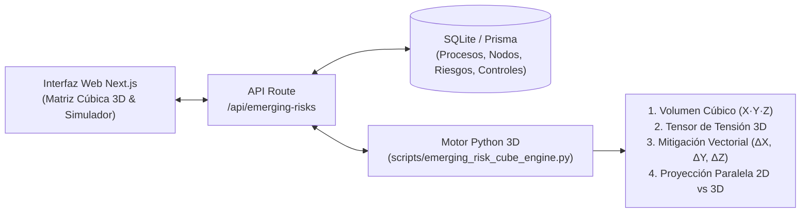

# Documento de Definición Arquitectónica, Metodológica y Funcional: Matriz Cúbica de Riesgos Emergentes ($5 \times 5 \times 5$) y Motor Python 3D

**Proyecto:** Plataforma Inteligente de Gestión de Riesgos Relevantes y Emergentes — Banco Ve por Más (B×+)  
**Documento:** Especificación Funcional, Matemática y Técnica del Módulo **"Matriz de Riesgos Emergentes (Cubo 3D)"** y su incorporación en **"Metodología & Marco Teórico"**  
**Fecha:** 23 de octubre de 2026

---

## 1. Justificación Estratégica y Regulatoria: ¿Por qué un Cubo 3D en paralelo a la Matriz $5\times 5$ Tradicional?

Las matrices bidimensionales tradicionales de Riesgo Operacional ($5\times 5$: **Probabilidad Frecuentista $\times$ Impacto Financiero**) están diseñadas bajo el supuesto de que el pasado es un buen predictor del futuro. Sin embargo, para **Riesgos Emergentes y Amenazas Sistémicas Complejas**, la matriz 2D presenta dos puntos ciegos críticos:

1. **Sesgo de Baja Probabilidad Histórica:** Un evento sin precedentes estadísticos frecuentes (ej. un ataque coordinado con IA sobre el conector SPEI o una corrida digital de liquidez en redes sociales) suele clasificarse con *"Probabilidad Baja ($P=1\text{ o }2$)"* en la matriz tradicional, quedando oculto en zona Amarilla o Verde a pesar de su potencial destructivo.
2. **Invisibilidad del Tiempo de Reacción (*Time-to-Impact*):** La matriz 2D trata igual un riesgo que tarda **6 meses** en materializarse que uno que colapsa la operación en **15 minutos** (donde los comités ordinarios no alcanzan a sesionar).

Por ello, B×+ adopta un **Modelo de Gestión Paralela**:
* **Matriz Bidimensional Tradicional ($5\times 5$ CNBV):** Evalúa el riesgo operativo recurrente mediante **Probabilidad ($P$) $\times$ Impacto ($I$)**.
* **Matriz Tridimensional de Riesgos Emergentes (Cubo $5\times 5\times 5$):** Evalúa amenazas complejas y sistémicas mediante tres ejes ortogonales procesados por un **motor cuantitativo especializado en Python**:
  $$\text{Eje } X \text{ (Impacto Sistémico / Contagio)} \times \text{Eje } Y \text{ (Incertidumbre)} \times \text{Eje } Z \text{ (Velocidad de Materialización)}$$

---

## 2. Taxonomía de las 8 Categorías de Riesgos Emergentes en B×+

El modelo tridimensional clasifica y monitorea de forma especializada las **8 familias de amenazas emergentes** definidas para la institución:

| Código | Categoría de Riesgo Emergente | Descripción y Vector de Materialización en B×+ | Procesos Bancarios Principalmente Expuestos |
| :--- | :--- | :--- | :--- |
| **`TECH_CONCENTRATION`** | **1. Concentración Tecnológica y Nube** | Dependencia crítica de un número reducido de proveedores cloud, motores de core bancario o APIs de infraestructura sin sustitución inmediata. | `PR-TI-01` (Continuidad SPEI y Parches) y transversal |
| **`CYBER_ADVANCED`** | **2. Ciberataques Avanzados** | Ransomware destructivo, explotación *zero-day*, secuestro de sesiones privilegiadas o ataques automatizados asistidos por IA. | `PR-TI-01`, `PR-TES-01` |
| **`DIGITAL_FRAUD`** | **3. Fraude Sofisticado e Identidad Sintética** | Suplantación biométrica (*deepfakes*), ingeniería social ejecutiva (BEC), alteración de instrucciones de pago o colusión interna/externa. | `PR-CRED-02`, `PR-TES-01`, `PR-AGRO-01` |
| **`SYSTEMIC_CONTAGION`** | **4. Contagio Sistémico e Inter-Procesos** | Efecto dominó donde la falla de un nodo operativo o contraparte financiera propaga pérdidas en cascada hacia la solvencia (`ICAP`) o reputación. | `PR-TES-01`, `PR-CRED-02` |
| **`THIRD_PARTY_EXTENDED`** | **5. Riesgos de Terceros y Cuartas Partes** | Interrupción o brecha de seguridad originada en proveedores críticos de tecnología, despachos valuadores/notariales o corresponsales. | `PR-CRED-02`, `PR-TI-01` |
| **`CLIMATE_FINANCIAL`** | **6. Riesgo Climático-Financiero (ESG)** | Choques físicos agudos (sequía extrema CONAGUA, fenómenos hidrometeorológicos) o de transición que deterioran simultáneamente carteras regionales. | `PR-AGRO-01` (Originación Agroindustrial) |
| **`DIGITAL_LIQUIDITY`** | **7. Liquidez Digital y Corridas Instantáneas** | Salida acelerada de depósitos o cierre abrupto de líneas interbancarias detonado por rumores virales y transferencias digitales 24/7. | `PR-TES-01` (Liquidez Intradía y FX) |
| **`MODEL_DATA_AI`** | **8. Riesgo de Modelos, Algoritmos y Datos / IA** | Deriva de modelos (*model drift*), sesgos algorítmicos, alucinaciones de IA, corrupción de linaje de datos o fallas en reglas de decisión automatizadas. | Transversal (`PR-AGRO-01`, `PR-TES-01`, `PR-CRED-02`) |

---

## 3. Definición Matemática y Escalas de los Tres Ejes ($X, Y, Z \in \{1..5\}$)

Cada riesgo emergente se posiciona dentro de un espacio tridimensional discreto-continuo de **$5 \times 5 \times 5 = 125$ celdas cúbicas (vóxeles)**, tanto en estado **Inherente** $(X_{\text{inh}}, Y_{\text{inh}}, Z_{\text{inh}})$ como en estado **Residual** $(X_{\text{res}}, Y_{\text{res}}, Z_{\text{res}})$.

### 3.1 Eje $X$: Impacto Sistémico o Potencial de Contagio ($1$ a $5$)
Mide la severidad del daño financiero/reputacional y su **capacidad de propagación (efecto dominó)** hacia otros nodos del diagrama de procesos, otras líneas de negocio o el sistema financiero.

| Nivel $X$ | Etiqueta | Criterio de Contagio y Alcance Sistémico | Umbral de Referencia |
| :-: | :--- | :--- | :--- |
| **1** | **Aislado / Local** | Afectación confinada a un único nodo operativo con contención inmediata y cero propagación a clientes. | $< 0.25\%$ Capital Neto |
| **2** | **Acotado a Proceso** | Degradación temporal de un proceso interno sin contagio a otros macroprocesos ni afectación regulatoria. | $0.25\% - 0.75\%$ Capital Neto |
| **3** | **Contagio Inter-Procesos** | El fallo se propaga entre $2$ o más procesos bancarios conectados o genera alertas preventivas en KRIs. | $0.75\% - 2.0\%$ Capital Neto |
| **4** | **Transversal Institucional** | Contagio hacia canales críticos de clientes, tesorería o cartera, comprometiendo umbrales de Tolerancia RAF. | $2.0\% - 5.0\%$ Capital Neto |
| **5** | **Sistémico / Crítico BCP** | Efecto dominó sobre procesos críticos BCP (SPEI, Liquidez, Solvencia ICAP), riesgo reputacional viral o sanción grave CNBV/Banxico. | $> 5.0\%$ Capital Neto |

### 3.2 Eje $Y$: Incertidumbre Epistémica ($1$ a $5$)
Reemplaza a la probabilidad frecuentista tradicional. Evalúa el **grado de desconocimiento, falta de historia estadística, complejidad causal e imprevisibilidad** del evento.

| Nivel $Y$ | Etiqueta | Criterio de Imprevisibilidad y Disponibilidad de Información |
| :-: | :--- | :--- |
| **1** | **Conocido / Predecible** | Existen series históricas robustas, distribuciones estadísticas claras y señales de alerta bien calibradas. |
| **2** | **Incertidumbre Baja** | Fenómeno documentado en el sector bancario con variaciones moderadas en su forma de presentarse. |
| **3** | **Incertidumbre Moderada** | Amenaza en evolución con datos históricos limitados; los modelos tradicionales presentan desviaciones. |
| **4** | **Alta Ambigüedad** | Vector emergente complejo (ej. nuevo patrón de ataque o choque exógeno) sin precedentes directos en la institución. |
| **5** | **Cisne Negro / Ignorancia Radical** | Evento altamente impredecible o inédito, con dinámicas no lineales donde no existen parámetros históricos fiables. |

### 3.3 Eje $Z$: Velocidad de Materialización / *Time-to-Impact* ($1$ a $5$)
Evalúa **qué tan rápido se desarrolla y golpea el riesgo una vez desencadenado**, determinando la ventana de tiempo real que tiene B×+ para reaccionar antes de sufrir el impacto máximo.

| Nivel $Z$ | Etiqueta | Ventana de Materialización (*Onset Speed*) | Capacidad de Reacción Humana vs. Automática |
| :-: | :--- | :--- | :--- |
| **1** | **Muy Lenta / Secular** | **$> 6$ meses** | Permite planeación estratégica y aprobación en sesiones ordinarias del CAIR. |
| **2** | **Gradual / Trimestral** | **$1\text{ a }6$ meses** | Permite desplegar planes tácticos y ajustes de políticas antes del impacto. |
| **3** | **Rápida / Semanal** | **$1\text{ a }4$ semanas** | Requiere activación de grupos de respuesta rápida e intervención de 1.ª y 2.ª línea. |
| **4** | **Aguda / Intradía-48h** | **$4\text{ a }72$ horas** | Supera los ciclos de reporte manual; exige protocolos de contingencia pre-armados. |
| **5** | **Instantánea / Algorítmica** | **Minutos a $< 4$ horas** | El humano llega tarde: **solo controles automatizados en tiempo real (*Kill-Switch*, EDR, límites intradía)** pueden contenerlo. |

---

## 4. Arquitectura del Motor Especializado en Python e Integración Paralela

Para cumplir con el requerimiento técnico de procesamiento matemático tridimensional, la solución integra un **Motor Cuantitativo en Python (`scripts/emerging_risk_cube_engine.py`)** conectado de forma nativa con la capa de servicios de Next.js (`/api/emerging-risks`).

### 4.1 Flujo de Procesamiento Técnico

### 4.2 Lógica Matemática del Motor Python (`emerging_risk_cube_engine.py`)

1. **Volumen Cúbico Bruto ($V \in [1, 125]$):**
   $$V_{\text{inh}} = X_{\text{inh}} \times Y_{\text{inh}} \times Z_{\text{inh}}, \qquad V_{\text{res}} = X_{\text{res}} \times Y_{\text{res}} \times Z_{\text{res}}$$

2. **Índice Compuesto de Tensión Emergente ($T_{\text{3D}} \in [1, 100]$) y Score Homologado ($S_{\text{eq}} \in [1, 25]$):**
   El motor en Python calcula la norma euclidiana ponderada en el espacio $\mathbb{R}^3$ junto con un **Factor de Sinergia Crítica ($\gamma$)** cuando coexisten alto contagio ($X \ge 4$) y velocidad instantánea ($Z \ge 4$):
   $$T_{\text{3D}} = \min\left(100,\; \left(0.45 \cdot \frac{V}{125} + 0.55 \cdot \frac{w_x X^2 + w_y Y^2 + w_z Z^2}{25}\right) \times 100 \times \gamma(X,Z)\right)$$
   donde $w_x = 0.40$ (Contagio), $w_z = 0.35$ (Velocidad), $w_y = 0.25$ (Incertidumbre), y $\gamma(X,Z) = 1.15$ si $(X \ge 4 \land Z \ge 4)$.

3. **Mitigación Vectorial en 3 Ejes ($\Delta X, \Delta Y, \Delta Z$) con Regla CNBV Art. 88:**
   A diferencia de la matriz 2D, cada control o plan de acción mitiga de manera diferenciada cada eje del cubo:
   * **Aislamiento / Redundancia / BCP** $\rightarrow$ Reduce el **Eje $X$ (Contagio Sistémico)**.
   * **Sensores KRI / Threat Intelligence / Modelos Predictivos** $\rightarrow$ Reduce el **Eje $Y$ (Incertidumbre)**.
   * **Contención Automatizada En Línea (`ONLINE_REALTIME`)** $\rightarrow$ Reduce el **Eje $Z$ (Velocidad de Materialización)** *(un control manual mensual no puede frenar un riesgo con $Z=5$)*.
   * **Penalización Art. 88 CUB:** Si un control está en estado **No Formalizado (`NF`)**, su capacidad de desaceleración o contención en el cubo se topa automáticamente al nivel `2` (máximo $20\%$ de reducción vectorial).

4. **Zonificación del Cubo Tridimensional (4 Zonas de Severidad 3D):**
   * 🔴 **ZONA CRÍTICA SISTÉMICA (RED):** $V_{\text{res}} \ge 64$ o $(X_{\text{res}} \ge 4 \land Z_{\text{res}} \ge 4)$. Requiere protocolo de respuesta automática y escalamiento inmediato al CAIR.
   * 🟠 **ZONA DE ALERTA TEMPRANA (ORANGE):** $36 \le V_{\text{res}} < 64$ o $(X_{\text{res}} = 5 \text{ o } Z_{\text{res}} = 5)$. Excede tolerancia; requiere *Quick-Win* de contención o sensores KRI.
   * 🟡 **ZONA DE VIGILANCIA / INCUBACIÓN (YELLOW):** $15 \le V_{\text{res}} < 36$. Monitoreo continuo de evolución de incertidumbre y velocidad.
   * 🟢 **ZONA LATENTE / CONTROLADA (GREEN):** $V_{\text{res}} < 15$. Dentro del apetito de riesgo emergente.

5. **Diagnóstico de Brecha de Visibilidad ("Efecto Punto Ciego 2D vs. 3D"):**
   El motor en Python compara la zona del riesgo en la **Matriz Operativa $5\times 5$ (2D)** contra su zona en el **Cubo Emergente $5\times 5\times 5$ (3D)** e identifica automáticamente los **"Riesgos Subestimados en 2D"** (eventos que en $P \times I$ lucen Moderados por baja frecuencia histórica, pero en $X \times Y \times Z$ son Críticos por alta incertidumbre y velocidad instantánea).

---

## 5. Diseño de la Nueva Sección en la Herramienta: Pestaña "Matriz Riesgos Emergentes (Cubo 3D)"

Se agregará una pestaña dedicada en la barra de navegación principal (junto a *Matriz 5×5 & Heatmap*), manteniendo el vínculo con **Procesos Bancarios** y **Nodos del Diagrama**:

### 5.1 Barra Superior de Control y Telemetría del Motor Python
* **Filtro por Proceso Bancario (`CustomSelect`) y por las 8 Categorías de Riesgos Emergentes.**
* **Switch de Estado del Cubo:** `Cubo Inherente (Sin Controles)` $\longleftrightarrow$ `Cubo Residual (Con Controles Art. 88)` $\longleftrightarrow$ `Comparativa Paralela 2D vs. 3D`.
* **Badge de Estado del Motor Python:** Indicador en vivo del motor `Python 3D Cube Engine (v3.x)` con tiempo de cómputo en milisegundos y botón para recalibrar/simular en tiempo real.

### 5.2 KPIs Superiores del Cubo Tridimensional (4 Tarjetas Ejecutivas)
1. **Riesgos en Vórtice Crítico 3D (Zona Roja):** Conteo de amenazas con alta combinación $X \times Y \times Z$ y su exposición máxima (`PMA` sistémica).
2. **Amenazas de Velocidad Instantánea ($Z \ge 4$):** Riesgos que se materializan en minutos/horas y que exigen controles automatizados `ONLINE_REALTIME`.
3. **Alerta de "Puntos Ciegos 2D $\rightarrow$ 3D":** Número de riesgos que la matriz tradicional $5\times 5$ clasificaba en Amarillo/Verde pero que el Cubo 3D descubre en Naranja/Rojo.
4. **Índice de Contagio Sistémico Promedio ($\bar{X}_{\text{res}}$) & Incertidumbre ($\bar{Y}_{\text{res}}$):** Salud global frente a las 8 categorías emergentes.

### 5.3 Visualizador Interactivo del Cubo $5 \times 5 \times 5$ y Proyecciones Ortogonales
* **Vista Principal — Cubo Tridimensional Interactivo ($5 \times 5 \times 5$):**
  * Representación tridimensional interactiva (con controles de rotación de perspectiva / ángulo y filtro de corte por **Capas de Velocidad $Z = 1..5$**) donde se visualizan los vóxeles coloreados por zona y las esferas/nodos de cada riesgo emergente posicionadas en sus coordenadas $(X, Y, Z)$, con vectores que muestran su desplazamiento desde la coordenada Inherente hasta la Residual.
* **Vista Complementaria — Las 3 Caras / Proyecciones Ortogonales del Cubo ($5\times 5$ cada una):**
  * **Plano $X \times Z$ (Contagio vs. Velocidad):** Identifica amenazas de *Choque Relámpago*.
  * **Plano $X \times Y$ (Contagio vs. Incertidumbre):** Identifica *Cisnes Negros Sistémicos*.
  * **Plano $Y \times Z$ (Incertidumbre vs. Velocidad):** Identifica *Sorpresas Operativas*.

### 5.4 Panel Inspector del Riesgo Emergente, Simulador Vectorial Python y Gestión Paralela
Al seleccionar cualquier riesgo en el Cubo 3D (o en la tabla inferior):
* Muestra su **Proceso Bancario (`PR-TI-01`, `PR-TES-01`, etc.) y Nodo del Diagrama**, su **Categoría Emergente** (una de las 8 familias) y su comparativa lado a lado:
  * **En Matriz Tradicional 2D ($P \times I$):** Coordenada $(P, I)$, Score $/25$ y Zona.
  * **En Cubo Emergente 3D ($X \times Y \times Z$):** Coordenada $(X, Y, Z)$, Volumen $/125$, Tensión $T_{3D}$ y Zona.
* **Simulador Interactivo en Vivo con el Motor Python:** Permite mover sliders de $(X, Y, Z)$ o aplicar controles de *Aislamiento ($\Delta X$)*, *Sensores KRI ($\Delta Y$)* y *Automatización Kill-Switch ($\Delta Z$)* para recalcular instantáneamente en Python el nuevo volumen cúbico y persistir los cambios o **crear un Plan de Acción / Quick-Win 3LD en 1 clic**.

---

## 6. Incorporación en el Módulo 2: "Metodología & Marco Teórico" (`MethodologyView.tsx`)

Dentro de la sección **Metodología & Marco Teórico**, se agregará un nuevo capítulo interactivo titulado:
> **"10. Modelo Tridimensional de Riesgos Emergentes (Cubo $5\times 5\times 5$) y Gestión Paralela"**

Este capítulo incluirá:
1. **Fundamento Conceptual:** Diferencia entre el Riesgo Operacional Frecuentista (Matriz $5\times 5$: $P \times I$) y el Riesgo Emergente Complejo (Cubo $5\times 5\times 5$: $X \times Y \times Z$).
2. **Anatomía de los 3 Ejes ($X$ Impacto Sistémico/Contagio, $Y$ Incertidumbre, $Z$ Velocidad de Materialización):** Tablas de escalas del $1$ al $5$ y ejemplos bancarios reales en B×+.
3. **Catálogo de las 8 Amenazas Emergentes:** Tarjetas explicativas de *Concentración Tecnológica, Ciberataques, Fraude, Contagio, Terceros, Climático-Financiero, Liquidez Digital y Modelos/Datos*.
4. **Fórmulas del Motor Cúbico en Python y Mitigación por Eje:** Explicación matemática del Volumen Cúbico ($V = X \cdot Y \cdot Z$), el Tensor de Tensión 3D, la regla de que *la velocidad $Z=5$ solo se mitiga con controles automáticos en tiempo real*, y el esquema de **arquitectura paralela** dentro de B×+.
