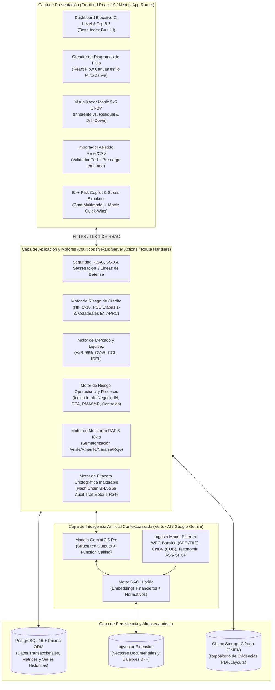
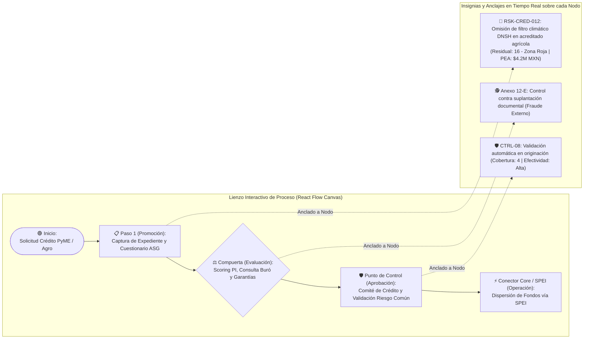
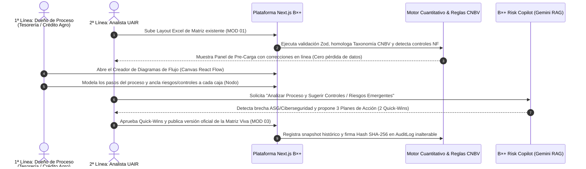
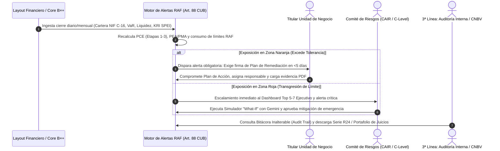
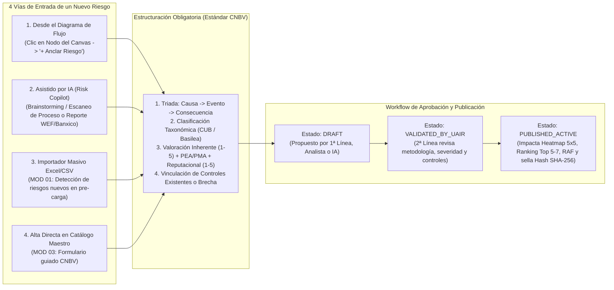

# Documento Maestro de Definición de Producto y Arquitectura Técnica: Herramienta Inteligente de Gestión de Riesgos Relevantes y Emergentes — Banco B×+

> [!IMPORTANT]
> **Propósito del Documento:** Este documento define exhaustivamente la arquitectura funcional y técnica, el esquema de base de datos en **Prisma ORM (PostgreSQL)**, el motor matemático de reglas de negocio en **Next.js (TypeScript)**, el **Creador de Diagramas de Flujo Interactivo (estilo Miro/Canva)**, los layouts de ingesta financiera, la automatización de la **Matriz 5x5 CNBV y Alertas RAF**, el diseño del **Agente IA (Gemini Risk Copilot + RAG)**, los **User Journeys** por rol regulatorio y la **Metodología Integral** de la plataforma para **Grupo Financiero Ve por Más (B×+)**.

---

## 1. Arquitectura General del Sistema y Stack Tecnológico

### 1.1 Diagrama de Arquitectura Tecnológica (Next.js + Prisma + PostgreSQL/pgvector + Gemini)

La plataforma se diseña bajo una arquitectura moderna, modular, auditable y de alta seguridad bancaria:



### 1.2 Especificaciones del Stack Tecnológico y Diseño UI/UX (*Taste Index B×+*)
- **Framework Full-Stack:** Next.js (App Router, Server Components, Server Actions y API Routes tipadas).
- **ORM y Base de Datos:** Prisma ORM sobre PostgreSQL 16 con extensión `pgvector` para búsqueda semántica RAG e índices compuestos para consultas analíticas de matrices e históricos.
- **Motor de Diagramación (Canvas):** `@xyflow/react` (React Flow) personalizado con nodos bancarios (*Actividad Operativa, Punto de Control, Compuerta de Decisión, Validador de Fraude Anexo 12-E, Conector de Sistema Core/SPEI*).
- **Sistema de Diseño Institucional (*Taste Index B×+*):**
  - **Tipografía:** `Arvo` (Slab Serif Bold) para encabezados ejecutivos y cifras clave; `Inter` (Sans Serif) para interfaz, tablas densas, lienzo de procesos y matriz 5x5.
  - **Paleta:** Header y navegación principal en Carbono (`#1F242B`), botón insignia de conversión/IA y acentos activos en Verde Lima B×+ (`#C0D725`), enlaces y *drill-downs* en Azul Turquesa (`#3299A8`), tarjetas blancas (`#FFFFFF`) con `border-radius: 10px` sobre superficie gris neutra (`#F5F7F9`).
  - **Widgets Flotantes:** Tarjeta flotante de Alertas RAF y *Tips de Control* en la esquina inferior izquierda con borde superior en `#C0D725`.

---

## 2. Componente 1: Modelado de Datos Base Exhaustivo (`schema.prisma`)

El esquema de datos ha sido diseñado para soportar simultáneamente:
1. La **jerarquía de procesos y diagramas de flujo interactivos** (Macroproceso $\rightarrow$ Proceso $\rightarrow$ Subproceso $\rightarrow$ Nodo Visual en Canvas).
2. La **taxonomía oficial de la CNBV** y el cálculo de **Riesgo Inherente vs. Residual (Matriz 5x5)** y **PEA / PMA (VaR Operacional)**.
3. Los **motores cuantitativos regulatorios** (**PCE NIF C-16**, **VaR/CVaR/IDEL**, **Indicador de Negocio IN**, **ASG Taxonomía Sostenible**).
4. La **evaluación técnica de controles** (Cobertura, Efectividad, Penalización Temporal y Formalización), **KRIs**, **Marco de Apetito al Riesgo (RAF)**, **Planes de Acción (Matriz Quick-Wins)** y **Bitácora de Auditoría Inalterable con encadenamiento SHA-256**.

```prisma
// prisma/schema.prisma
generator client {
  provider        = "prisma-client-js"
  previewFeatures = ["postgresqlExtensions"]
}

datasource db {
  provider   = "postgresql"
  url        = env("DATABASE_URL")
  extensions = [vector]
}

// ============================================================================
// 1. GOBERNANZA, SEGURIDAD (RBAC) Y TRES LÍNEAS DE DEFENSA
// ============================================================================

enum RoleType {
  C_LEVEL_CAIR          // Miembro del Consejo / CAIR (Vista ejecutiva y aprobación de límites)
  UAIR_ADMIN            // 2ª Línea: Administrador de Riesgos (Parametriza RAF, metodologías y valida)
  UAIR_ANALYST          // 2ª Línea: Analista de Riesgos (Modelado, pruebas de estrés, copilot)
  PROCESS_OWNER         // 1ª Línea: Dueño de Proceso / Unidad de Negocio (Tesorería, Crédito, etc.)
  CONTROL_OWNER         // 1ª Línea: Responsable de ejecutar controles y subir evidencias
  INTERNAL_AUDITOR      // 3ª Línea: Auditoría Interna / Inspector CNBV (Solo lectura + Audit Trail)
}

enum BusinessLineBancoBx {
  BANCA_EMPRESARIAL_CORPORATIVA
  BANCA_PYME
  AGRONEGOCIOS
  TESORERIA_MERCADO_DINERO
  DERIVADOS_Y_CAMBIOS
  BANCA_PATRIMONIAL_PRIVADA
  ARRENDAMIENTO_FACTORING
  OPERACIONES_Y_SPEI
  TI_Y_CIBERSEGURIDAD
}

model User {
  id               String         @id @default(cuid())
  email            String         @unique
  fullName         String
  role             RoleType
  businessUnitId   String?
  businessUnit     BusinessUnit?  @relation(fields: [businessUnitId], references: [id])
  active           Boolean        @default(true)
  createdAt        DateTime       @default(now())

  ownedProcesses   Process[]
  ownedRisks       RiskEvent[]
  ownedControls    Control[]
  ownedKRIs        KRI[]
  actionPlans      ActionPlan[]
  auditLogs        AuditLog[]
}

model BusinessUnit {
  id               String              @id @default(cuid())
  code             String              @unique // Ej. "TES-01", "CRED-AGRO", "CRED-PYME", "OP-SPEI"
  name             String              // Ej. "Tesorería y Mercado de Dinero", "Banca Agropecuaria"
  businessLine     BusinessLineBancoBx
  users            User[]
  macroProcesses   MacroProcess[]
  riskEvents       RiskEvent[]
  rafThresholds    RAFThreshold[]
  financialUploads FinancialLayoutUpload[]
}

// ============================================================================
// 2. CADENA DE VALOR Y CREADOR DE DIAGRAMAS DE FLUJO (CANVAS REACT FLOW)
// ============================================================================

enum ProcessCategory {
  BUSINESS // Procesos de Negocio (Originación, Suscripción, Tesorería, Inversión)
  SUPPORT  // Procesos de Soporte (TI, Legal, Contabilidad, Reporteo Regulatorio)
}

enum CreditCycleStage {
  PROMOTION        // Promoción comercial (Separación obligatoria CUB)
  EVALUATION       // Evaluación y análisis de riesgo
  APPROVAL         // Aprobación / Comité
  INSTRUMENTATION  // Formalización, desembolso y operación
  CONTROL_RECOVERY // Control, monitoreo y cobranza
  NOT_APPLICABLE
}

enum FlowNodeType {
  START_END        // Inicio / Fin del proceso
  TASK_STEP        // Paso operativo o actividad
  DECISION_GATEWAY // Compuerta lógica (Sí/No, Umbral de autorización)
  CONTROL_POINT    // Punto de control embebido en el flujo
  FRAUD_CHECKPOINT // Control de Conducta Observable de Fraude (Anexo 12-E)
  EXTERNAL_SYSTEM  // Conexión con Core Bancario, SPEI, Bloomberg, Proveedor Externo
}

model MacroProcess {
  id               String          @id @default(cuid())
  code             String          @unique // Ej. "MP-NEG-01"
  name             String          // Ej. "Administración de Portafolio e Inversiones"
  category         ProcessCategory
  businessUnitId   String
  businessUnit     BusinessUnit    @relation(fields: [businessUnitId], references: [id])
  processes        Process[]
  createdAt        DateTime        @default(now())
}

model Process {
  id               String         @id @default(cuid())
  code             String         @unique // Ej. "PR-INV-01"
  name             String         // Ej. "Operaciones de Money Market y Liquidez"
  description      String?
  macroProcessId   String
  macroProcess     MacroProcess   @relation(fields: [macroProcessId], references: [id])
  ownerId          String
  owner            User           @relation(fields: [ownerId], references: [id])
  isCriticalBCP    Boolean        @default(false) // Crítico para Continuidad de Negocio
  rtoHours         Int?           // Recovery Time Objective (Horas)
  rpoHours         Int?           // Recovery Point Objective (Horas)
  canvasViewport   Json?          // Estado visual del zoom/pan en React Flow
  subProcesses     SubProcess[]
  flowNodes        ProcessNode[]
  flowEdges        ProcessEdge[]
  riskEvents       RiskEvent[]
  updatedAt        DateTime       @updatedAt
}

model SubProcess {
  id               String         @id @default(cuid())
  code             String         @unique
  name             String
  processId        String
  process          Process        @relation(fields: [processId], references: [id], onDelete: Cascade)
  flowNodes        ProcessNode[]
  riskEvents       RiskEvent[]
}

model ProcessNode {
  id               String           @id @default(cuid())
  processId        String
  process          Process          @relation(fields: [processId], references: [id], onDelete: Cascade)
  subProcessId     String?
  subProcess       SubProcess?      @relation(fields: [subProcessId], references: [id])
  nodeType         FlowNodeType     @default(TASK_STEP)
  creditStage      CreditCycleStage @default(NOT_APPLICABLE)
  label            String           // Título visible en la caja del diagrama
  description      String?
  responsibleRole  String?          // Ej. "Trader Mesa Dinero", "Back Office"
  systemUsed       String?          // Ej. "SPEI", "Bloomberg", "PMS", "Core Bancario"
  positionX        Float            // Coordenada X en el Canvas
  positionY        Float            // Coordenada Y en el Canvas
  styleConfig      Json?            // Configuración visual (color, icono, bordes)
  bcpThreatDim     String[]         // ["EMPLOYEES", "INFRASTRUCTURE", "SUPPLIERS", "TECHNOLOGY"]

  // Relaciones directas desde el nodo del diagrama hacia Riesgos y Controles
  riskEvents       RiskEvent[]
  controls         Control[]
  outgoingEdges    ProcessEdge[]    @relation("SourceNode")
  incomingEdges    ProcessEdge[]    @relation("TargetNode")
}

model ProcessEdge {
  id               String      @id @default(cuid())
  processId        String
  process          Process     @relation(fields: [processId], references: [id], onDelete: Cascade)
  sourceNodeId     String
  sourceNode       ProcessNode @relation("SourceNode", fields: [sourceNodeId], references: [id], onDelete: Cascade)
  targetNodeId     String
  targetNode       ProcessNode @relation("TargetNode", fields: [targetNodeId], references: [id], onDelete: Cascade)
  conditionLabel   String?     // Ej. "Monto > $500k USD", "Rechazado"
  animated         Boolean     @default(false)
}

// ============================================================================
// 3. TAXONOMÍA CNBV, MATRIZ 5x5 VIVA Y CUANTIFICACIÓN PEA / PMA
// ============================================================================

enum RiskClassification {
  QUANTIFIABLE_DISCRETIONARY     // Crédito, Mercado, Liquidez
  QUANTIFIABLE_NON_DISCRETIONARY // Operacional, Tecnológico, Legal
  NON_QUANTIFIABLE_EMERGING      // Ciberseguridad, ASG/Climático, Reputacional, Estratégico
}

enum RiskTypeCNBV {
  CREDIT
  MARKET
  LIQUIDITY
  OPERATIONAL
  TECHNOLOGICAL
  LEGAL
  CYBERSECURITY
  ESG_CLIMATE
  REPUTATIONAL
  STRATEGIC
  FRAUD_INTERNAL_EXTERNAL
}

enum RiskOrigin {
  PROCESSES
  PEOPLE
  TECHNOLOGY
  EXTERNAL_EVENTS
  THIRD_PARTY_SUPPLIERS
}

enum RAFZone {
  GREEN  // Zona Verde: Dentro del Apetito (Bajo)
  YELLOW // Zona Amarilla: Entre Apetito y Tolerancia (Moderado / Preventivo)
  ORANGE // Zona Naranja: Excede Tolerancia (Alto / Plan de Remediación Obligatorio)
  RED    // Zona Roja: Transgresión de Límite (Crítico / Escalamiento a CAIR)
}

model RiskTaxonomy {
  id               String             @id @default(cuid())
  code             String             @unique // Ej. "RO-N1-07", "CIB-SPEI-01"
  classification   RiskClassification
  riskType         RiskTypeCNBV
  baselLevel1      String             // Ej. "Ejecución, entrega y gestión de procesos"
  baselLevel2      String             // Ej. "Recepción, ejecución y mantenimiento de operaciones"
  baselLevel3      String?            // Ej. "Errores en introducción de datos"
  cnbvReference    String?            // Ej. "CUB Anexo 12-A / Anexo 64 Bis"
  riskEvents       RiskEvent[]
}

model RiskEvent {
  id                      String        @id @default(cuid())
  code                    String        @unique // Ej. "RSK-TES-042"
  title                   String
  cause                   String        // Causa raíz estructurada (Estándar CNBV)
  eventDescription        String        // Evento de riesgo
  consequence             String        // Consecuencia / Efecto financiero o normativo
  taxonomyId              String
  taxonomy                RiskTaxonomy  @relation(fields: [taxonomyId], references: [id])
  origin                  RiskOrigin
  businessUnitId          String
  businessUnit            BusinessUnit  @relation(fields: [businessUnitId], references: [id])
  processId               String
  process                 Process       @relation(fields: [processId], references: [id])
  subProcessId            String?
  subProcess              SubProcess?   @relation(fields: [subProcessId], references: [id])
  processNodeId           String?       // Anclaje directo a la caja del Diagrama de Flujo
  processNode             ProcessNode?  @relation(fields: [processNodeId], references: [id])
  ownerId                 String
  owner                   User          @relation(fields: [ownerId], references: [id])

  // Valoración Matriz 5x5 CNBV — Riesgo Inherente (Sin controles)
  inherentProbability     Int           // Escala 1 a 5
  inherentImpact          Int           // Escala 1 a 5
  inherentScore           Float         // inherentProbability * inherentImpact (1 a 25)
  inherentZone            RAFZone

  // Valoración Matriz 5x5 CNBV — Riesgo Residual (Con controles)
  controlMitigationFactor Float         @default(0.0) // [0.0 a 0.85] calculado por motor de controles
  residualProbability     Float         // Escala continua 1.0 a 5.0
  residualImpact          Float         // Escala continua 1.0 a 5.0
  residualScore           Float         // Score residual (1.0 a 25.0)
  residualZone            RAFZone

  // Cuantificación Monetaria Operacional (Metodología Rimac / Basilea)
  annualFrequencyNet      Float         @default(0.0) // Ocurrencias netas esperadas por año (f)
  avgFinancialImpactMXN   Decimal       @default(0.0) @db.Decimal(18, 2) // Impacto medio (I_medio)
  worstCaseImpactMXN      Decimal       @default(0.0) @db.Decimal(18, 2) // Peor escenario (I_max)
  expectedAnnualLossPEA   Decimal       @default(0.0) @db.Decimal(18, 2) // PEA = f * I_medio
  maxAnnualLossPMA        Decimal       @default(0.0) @db.Decimal(18, 2) // PMA (VaR Operacional 99.9%)

  // Impacto No Financiero / Reputacional y Emergente
  reputationalImpactLevel Int           @default(1)   // Escala 1 a 5 (1=Interna limitada ... 5=Crisis medios/clientes)
  isEmergingRisk          Boolean       @default(false)
  cyberAttackVector       String?       // Anexo 64/72: Ej. "Ransomware", "Compromiso SPEI"
  speiImpact              Boolean       @default(false)
  esgSectorSHCP           String?       // Taxonomía Sostenible: "Agropecuario", "Energía", etc.
  esgDnshCompliant        Boolean?      // Criterio "Do No Significant Harm" (DNSH)
  criticalityRankScore    Float         @default(0.0) // Score compuesto para el Ranking "Top 5-7"

  controls                RiskControlMap[]
  kris                    KRI[]
  lossEvents              LossEvent[]
  actionPlans             ActionPlan[]
  historySnapshots        RiskMatrixSnapshot[]
  createdAt               DateTime      @default(now())
  updatedAt               DateTime      @updatedAt
}

// ============================================================================
// 4. CONTROLES INTERNOS, COBERTURA, EFECTIVIDAD Y PENALIZACIÓN TEMPORAL
// ============================================================================

enum ControlNature {
  PREVENTIVE // Evita la ocurrencia (d+0 / On-line)
  DETECTIVE  // Detecta durante o después de la ocurrencia
  CORRECTIVE // Mitiga el impacto una vez ocurrido
}

enum ControlExecutionTiming {
  ONLINE_REALTIME // En línea / Tiempo real (d+0) -> Permite efectividad "Muy Alta"
  DAILY_D1        // Ex-post diario (d+1) -> Techo máximo "Alta"
  WEEKLY_D7       // Ex-post semanal (d+7) -> Techo máximo "Media"
  MONTHLY_D30     // Ex-post mensual (d+30) -> Techo máximo "Baja"
  OCCASIONAL      // Esporádico / A petición
}

enum ControlAutomation {
  AUTOMATED       // 100% en sistema (ej. bloqueo automático en Core)
  SEMI_AUTOMATED  // Alerta en sistema + revisión humana
  MANUAL          // Revisión manual (ej. checklist o firma autógrafa)
}

model Control {
  id                  String                 @id @default(cuid())
  code                String                 @unique // Ej. "CTRL-TES-015"
  name                String
  description         String
  nature              ControlNature
  automation          ControlAutomation
  executionTiming     ControlExecutionTiming
  isFormalized        Boolean                @default(false) // Si es false (NF), Cobertura máx = 2
  fraudObservableCode String?                // Anexo 12-E: Código de conducta observable de fraude
  ownerId             String
  owner               User                   @relation(fields: [ownerId], references: [id])
  processNodeId       String?
  processNode         ProcessNode?           @relation(fields: [processNodeId], references: [id])

  // Escalas de Evaluación Técnica (Metodología Rimac / CNBV)
  coverageLevel       Int                    // 0=No existe, 1=No se aplica, 2=Ocasional, 3=Frecuente, 4=Siempre
  rawEffectiveness    Int                    // 0=Nula, 1=Muy Baja, 2=Baja, 3=Media, 4=Alta, 5=Muy Alta
  adjustedEffectScore Float                  // Efectividad ajustada por penalización temporal y formalización [0.0 - 1.0]
  hasValidEvidence    Boolean                @default(false)

  risks               RiskControlMap[]
  evidences           ControlEvidence[]
  actionPlans         ActionPlan[]
  updatedAt           DateTime               @updatedAt
}

model RiskControlMap {
  id                  String    @id @default(cuid())
  riskEventId         String
  riskEvent           RiskEvent @relation(fields: [riskEventId], references: [id], onDelete: Cascade)
  controlId           String
  control             Control   @relation(fields: [controlId], references: [id], onDelete: Cascade)
  mitigatesProbWeight Float     @default(0.5) // Peso de mitigación en Probabilidad
  mitigatesImpWeight  Float     @default(0.5) // Peso de mitigación en Impacto

  @@unique([riskEventId, controlId])
}

model ControlEvidence {
  id                  String    @id @default(cuid())
  controlId           String
  control             Control   @relation(fields: [controlId], references: [id], onDelete: Cascade)
  fileName            String
  fileUrl             String
  fileHashSha256      String    // Garantiza integridad del comprobante
  uploadedById        String
  validUntil          DateTime
  verifiedByUAIR      Boolean   @default(false)
  createdAt           DateTime  @default(now())
}

// ============================================================================
// 5. PLANES DE ACCIÓN, EVIDENCIAS Y MATRIZ QUICK-WINS
// ============================================================================

enum ActionPlanType {
  TECHNOLOGY
  PROCESSES
  ORGANIZATION
}

enum EffortScale {
  VERY_LOW  // Costo: $0-$60k MXN | Tiempo: 1-30 días
  LOW       // Costo: $60k-$200k MXN | Tiempo: 31-90 días
  MEDIUM    // Costo: $200k-$400k MXN | Tiempo: 91-180 días
  HIGH      // Costo: $400k-$1M MXN | Tiempo: 181-365 días
  VERY_HIGH // Costo: >$1M MXN | Tiempo: >365 días
}

enum PlanStatus {
  DRAFT
  APPROVED_COMMITTED
  IN_PROGRESS
  EVIDENCE_SUBMITTED
  VALIDATED_CLOSED
  OVERDUE_ESCALATED
}

model ActionPlan {
  id                       String           @id @default(cuid())
  code                     String           @unique // Ej. "PA-2026-008"
  title                    String
  description              String
  planTypes                ActionPlanType[] // Máximo 2 tipologías (Tecnología, Procesos, Organización)
  riskEventId              String
  riskEvent                RiskEvent        @relation(fields: [riskEventId], references: [id])
  controlId                String?
  control                  Control?         @relation(fields: [controlId], references: [id])
  ownerId                  String
  owner                    User             @relation(fields: [ownerId], references: [id])

  // Parámetros de la Matriz de Priorización (Potencial de Mejora vs. Esfuerzo)
  improvementPotentialPct  Float            // 0.0 a 1.0 (Ej. 0.80 = reduce 80% la PEA/PMA)
  estimatedCostMXN         Decimal          @db.Decimal(18, 2)
  costScale                EffortScale
  estimatedDays            Int              // Días estimados de implementación
  timeScale                EffortScale
  combinedEffortScore      Float            // Índice compuesto de esfuerzo (1.0 a 5.0)
  expectedPEAReductionMXN  Decimal          @db.Decimal(18, 2) // PEA_actual * improvementPotentialPct
  expectedPMAReductionMXN  Decimal          @db.Decimal(18, 2)
  isQuickWin               Boolean          @default(false) // true si Mejora >= 60% y Esfuerzo <= LOW
  isSuggestedByAI          Boolean          @default(false)

  status                   PlanStatus       @default(DRAFT)
  dueDate                  DateTime
  signedByBusinessHead     Boolean          @default(false) // Obligatorio cuando el riesgo está en Zona Naranja/Roja
  evidences                ActionPlanEvidence[]
  createdAt                DateTime         @default(now())
  updatedAt                DateTime         @updatedAt
}

model ActionPlanEvidence {
  id                  String     @id @default(cuid())
  actionPlanId        String
  actionPlan          ActionPlan @relation(fields: [actionPlanId], references: [id], onDelete: Cascade)
  fileName            String
  fileUrl             String
  fileHashSha256      String
  comments            String?
  approvedByUAIR      Boolean    @default(false)
  createdAt           DateTime   @default(now())
}

// ============================================================================
// 6. MARCO DE APETITO AL RIESGO (RAF Art. 88 CUB) E INDICADORES KRI
// ============================================================================

model RAFThreshold {
  id                  String       @id @default(cuid())
  metricCode          String       @unique // Ej. "ICAP", "CCL", "VAR_MKT", "IMOR_PYME", "PEA_OP"
  metricName          String
  riskType            RiskTypeCNBV
  businessUnitId      String?
  businessUnit        BusinessUnit? @relation(fields: [businessUnitId], references: [id])
  unit                String       // "%", "MXN", "Días", "Veces"
  direction           String       // "HIGHER_IS_WORSE" (ej. VaR, IMOR) o "LOWER_IS_WORSE" (ej. ICAP, CCL)

  // Los 4 Umbrales Regulatorios del Artículo 88 CUB
  appetiteValue       Float        // Límite entre Zona Verde y Zona Amarilla
  toleranceValue      Float        // Límite entre Zona Amarilla y Zona Naranja
  regulatoryLimitValue Float       // Límite entre Zona Naranja y Zona Roja
  capacityValue       Float        // Capacidad máxima de solvencia/liquidez

  currentValue        Float
  currentZone         RAFZone
  kris                KRI[]
  updatedAt           DateTime     @updatedAt
}

model KRI {
  id                  String          @id @default(cuid())
  code                String          @unique
  name                String
  description         String
  periodicity         String          // "DIARIO", "SEMANAL", "MENSUAL", "TRIMESTRAL"
  isImplemented       Boolean         @default(true)
  riskEventId         String
  riskEvent           RiskEvent       @relation(fields: [riskEventId], references: [id])
  rafThresholdId      String?
  rafThreshold        RAFThreshold?   @relation(fields: [rafThresholdId], references: [id])
  ownerId             String
  owner               User            @relation(fields: [ownerId], references: [id])
  greenMax            Float
  yellowMax           Float
  orangeMax           Float           // Por encima de orangeMax es ROJO
  currentValue        Float
  currentZone         RAFZone         @default(GREEN)
  measurements        KRIMeasurement[]
}

model KRIMeasurement {
  id                  String   @id @default(cuid())
  kriId               String
  kri                 KRI      @relation(fields: [kriId], references: [id], onDelete: Cascade)
  measuredAt          DateTime @default(now())
  value               Float
  zone                RAFZone
  triggeredAlert      Boolean  @default(false)
}

// ============================================================================
// 7. MOTORES CUANTITATIVOS FINANCIEROS (CRÉDITO NIF C-16, MERCADO, LIQUIDEZ, IN)
// ============================================================================

model CreditExposureNifC16 {
  id                  String   @id @default(cuid())
  periodDate          DateTime
  loanId              String   // Identificador del crédito o acreditado
  commonRiskGroupId   String?  // Grupo de Riesgo Común (Art. 2 Bis 69 CUB)
  portfolioSegment    String   // "EMPRESARIAL", "PYME", "AGROPECUARIO", "CONSUMO", "VIVIENDA"
  economicSectorSHCP  String?  // Sector Taxonomía Sostenible (ej. "Agropecuario y Forestal")
  daysPastDue         Int      // Días de mora
  hasQualitativeSICR  Boolean  @default(false) // Incremento significativo de riesgo cualitativo/climático
  nifStage            Int      // 1 = Etapa 1 (12m), 2 = Etapa 2 (Vida remanente), 3 = Etapa 3 (Vencida)

  // Parámetros de Cálculo PCE y Mitigación de Colateral
  grossExposureEI     Decimal  @db.Decimal(18, 2) // EI_t
  collateralValueC    Decimal  @default(0.0) @db.Decimal(18, 2) // Valor del colateral C
  haircutExposureHe   Float    @default(0.0) // He
  haircutCollateralHc Float    @default(0.0) // Hc
  haircutFxHfx        Float    @default(0.0) // Hfx
  adjustedExposureE   Decimal  @db.Decimal(18, 2) // E* ajustada por colateral
  pd12Months          Float    // PI a 12 meses
  pdLifetime          Float    // PI vida remanente
  lgdSeveritySP       Float    // SP_t (Severidad de la Pérdida)
  effectiveRate       Float    // Tasa de interés efectiva para descuento D_t
  remainingTermYears  Float    // Vida remanente en años
  expectedCreditLossPCE Decimal @db.Decimal(18, 2) // Reserva PCE calculada
  rwaAPRC             Decimal  @db.Decimal(18, 2) // Activos Ponderados por Riesgo (1.06 * P_RCRC * 12.5 * EI)
  esgClimateScore     Float?   // Score de vulnerabilidad física/transición (0 a 100)
}

model OperationalBusinessIndicator {
  id                  String   @id @default(cuid())
  calculationYear     Int      @unique // Año de cálculo (usa ventana trianual t-2, t-1, t)
  ilctComponentMXN    Decimal  @db.Decimal(18, 2) // Componente Intereses, Arrendamiento y Dividendos
  csComponentMXN      Decimal  @db.Decimal(18, 2) // Componente de Servicios
  fcComponentMXN      Decimal  @db.Decimal(18, 2) // Componente Financiero
  totalBusinessIndIN  Decimal  @db.Decimal(18, 2) // IN = ILCT + CS + FC
  regulatoryCapitalOP Decimal  @db.Decimal(18, 2) // Requerimiento de capital regulatorio por RO
  rawAccountingJson   Json     // Desglose de cuentas contables trianuales cargadas por Layout
  createdAt           DateTime @default(now())
}

model LossEvent {
  id                  String       @id @default(cuid())
  eventCode           String       @unique // Anexo 12-A CUB y Serie R24
  riskEventId         String?
  riskEvent           RiskEvent?   @relation(fields: [riskEventId], references: [id])
  occurrenceDate      DateTime
  discoveryDate       DateTime
  accountingDate      DateTime
  grossLossMXN        Decimal      @db.Decimal(18, 2)
  recoveryAmountMXN   Decimal      @default(0.0) @db.Decimal(18, 2)
  netLossMXN          Decimal      @db.Decimal(18, 2)
  channelAffected     String?      // Para Serie R24 (SPEI, Banca Móvil, Cajeros, Sucursales)
  downtimeMinutes     Int?         // Duración de indisponibilidad de canal (Serie R24)
  accountingAccount   String       // Cuenta contable afectada
}

model LegalPortfolioCase {
  id                  String   @id @default(cuid())
  caseNumber          String   @unique // Portafolio Global de Juicios
  legalType           String   // "MERCANTIL", "LABORAL", "FISCAL", "ADMINISTRATIVO_CNBV"
  claimedAmountMXN    Decimal  @db.Decimal(18, 2)
  adverseProbPct      Float    // Probabilidad de resolución desfavorable
  provisionedAmountMXN Decimal @db.Decimal(18, 2)
  status              String
  updatedAt           DateTime @updatedAt
}

// ============================================================================
// 8. HISTÓRICO, INGESTA DE LAYOUTS Y BITÁCORA DE AUDITORÍA INALTERABLE
// ============================================================================

model FinancialLayoutUpload {
  id                  String       @id @default(cuid())
  layoutType          String       // "MATRIZ_5X5", "CARTERA_NIF_C16", "INDICADOR_NEGOCIO_IN", " LIQUIDEZ_VAR"
  fileName            String
  businessUnitId      String
  businessUnit        BusinessUnit @relation(fields: [businessUnitId], references: [id])
  totalRows           Int
  validRows           Int
  errorRows           Int
  validationReport    Json         // Detalle de errores corregidos en línea
  status              String       // "PRE_LOAD", "VALIDATED", "PUBLISHED"
  createdAt           DateTime     @default(now())
}

model RiskMatrixSnapshot {
  id                  String    @id @default(cuid())
  snapshotPeriod      String    // Ej. "2026-Q3", "2026-10"
  riskEventId         String
  riskEvent           RiskEvent @relation(fields: [riskEventId], references: [id], onDelete: Cascade)
  inherentScore       Float
  residualScore       Float
  peaMXN              Decimal   @db.Decimal(18, 2)
  pmaMXN              Decimal   @db.Decimal(18, 2)
  zone                RAFZone
  createdAt           DateTime  @default(now())
}

model AuditLog {
  id                  String   @id @default(cuid())
  timestamp           DateTime @default(now())
  userId              String
  user                User     @relation(fields: [userId], references: [id])
  userRole            RoleType
  actionType          String   // "CREATE_RISK", "UPDATE_CONTROL", "OVERRIDE_RAF", "AI_SIMULATION", "EXPORT_R24"
  entityName          String
  entityId            String
  previousStateJson   Json?
  newStateJson        Json?
  ipAddress           String?
  previousHash        String   // Hash SHA-256 del registro anterior (Blockchain-like immutability)
  currentHash         String   @unique // SHA-256(previousHash + timestamp + userId + actionType + newStateJson)
}
```

---

## 3. Componente 2: Reglas de Negocio y Motor de Cálculo Matemático (Backend Next.js)

A continuación se presenta la implementación exacta en **TypeScript (Next.js Server Engine)** que traduce las disposiciones de la **CUB (CNBV)**, **NIF C-16**, **Basilea III** y la metodología cuantitativa **PEA/PMA (Rimac)** a funciones deterministas y auditables.

### 3.1 Motor de Riesgo de Crédito (PCE NIF C-16, Etapas 1–3, Colaterales $E^*$ y Estrés de PI)

```typescript
// src/lib/engines/credit-engine.ts

export interface CreditExposureInput {
  grossExposureEI: number;       // EI_t: Exposición al Incumplimiento Bruta (MXN)
  collateralValueC: number;      // C: Valor del colateral admisible (MXN)
  haircutExposureHe: number;     // H_e: Factor de ajuste a la exposición
  haircutCollateralHc: number;   // H_c: Factor de ajuste por volatilidad del colateral
  haircutFxHfx: number;          // H_fx: Factor por descalce de moneda
  pd12Months: number;            // PI_12m: Probabilidad de incumplimiento a 12 meses [0, 1]
  pdAnnualCurve: number[];       // Vector de PI marginal por cada año remanente t = 1..T
  lgdSeveritySP: number;         // SP_t: Severidad de la pérdida [0, 1]
  lgdDefaultedStage3: number;    // SP en Etapa 3 considerando ejecución real de garantías
  effectiveInterestRate: number; // r_eff: Tasa de interés efectiva anual
  daysPastDue: number;           // Días de mora
  hasQualitativeSICR: boolean;   // Deterioro sectorial, reestructura o vulnerabilidad ASG alta
  esgClimateVulnerability?: number; // Score 0 a 100 de autodiagnóstico climático CNBV
}

export interface CreditCalculationResult {
  stage: 1 | 2 | 3;
  adjustedExposureEStar: number;
  expectedCreditLossPCE: number;
  rwaAPRC: number;
  reserveCoveragePct: number;
}

/**
 * 1. Mitigación de Exposición por Colateral Admisible (CUB):
 * E* = max{ 0, [ E * (1 + He) - C * (1 - Hc - Hfx) ] }
 */
export function calculateCollateralAdjustedExposure(input: CreditExposureInput): number {
  const { grossExposureEI, collateralValueC, haircutExposureHe, haircutCollateralHc, haircutFxHfx } = input;
  const adjusted =
    grossExposureEI * (1 + haircutExposureHe) -
    collateralValueC * (1 - haircutCollateralHc - haircutFxHfx);
  return Math.max(0, Number(adjusted.toFixed(2)));
}

/**
 * 2. Clasificación Dinámica de Etapas (NIF C-16 y Anexo 15 Bis CUB)
 */
export function classifyNifC16Stage(input: CreditExposureInput): 1 | 2 | 3 {
  if (input.daysPastDue >= 90) {
    return 3; // Etapa 3: Cartera Vencida / Deterioro Crediticio Objetivo
  }
  if (
    input.daysPastDue >= 30 ||
    input.hasQualitativeSICR ||
    (input.esgClimateVulnerability !== undefined && input.esgClimateVulnerability >= 75)
  ) {
    return 2; // Etapa 2: Incremento Significativo en el Riesgo Crediticio (SICR)
  }
  return 1; // Etapa 1: Riesgo Normal
}

/**
 * 3. Cálculo Prospectivo de Pérdida Crediticia Esperada (PCE_t = PI_t * SP_t * EI_t * D_t)
 */
export function calculateNifC16PCE(input: CreditExposureInput): CreditCalculationResult {
  const stage = classifyNifC16Stage(input);
  const adjustedExposureEStar = calculateCollateralAdjustedExposure(input);
  const r = input.effectiveInterestRate;

  let pce = 0;

  if (stage === 1) {
    // Etapa 1: Horizonte de 12 meses (t = 1)
    const discountFactorD1 = Math.pow(1 + r, -1);
    pce = input.pd12Months * input.lgdSeveritySP * adjustedExposureEStar * discountFactorD1;
  } else if (stage === 2) {
    // Etapa 2: Horizonte de vida remanente completa (t = 1..T)
    pce = input.pdAnnualCurve.reduce((acc, pd_t, idx) => {
      const t = idx + 1;
      const discountFactorDt = Math.pow(1 + r, -t);
      return acc + pd_t * input.lgdSeveritySP * adjustedExposureEStar * discountFactorDt;
    }, 0);
  } else {
    // Etapa 3: PI = 100% (1.0), descontado y evaluando severidad de cartera vencida
    const discountFactorD1 = Math.pow(1 + r, -1);
    pce = 1.0 * input.lgdDefaultedStage3 * adjustedExposureEStar * discountFactorD1;
  }

  // Cálculo de Activos Ponderados por Riesgo de Crédito (APRC = 1.06 * P_RCRC * 12.5 * EI)
  // Donde P_RCRC es el requerimiento de capital por riesgo de crédito (8% * ponderador)
  const riskWeightFactor = stage === 3 ? 1.5 : stage === 2 ? 1.0 : 0.75;
  const pRcrc = 0.08 * riskWeightFactor;
  const rwaAPRC = 1.06 * pRcrc * 12.5 * adjustedExposureEStar;

  return {
    stage,
    adjustedExposureEStar,
    expectedCreditLossPCE: Number(pce.toFixed(2)),
    rwaAPRC: Number(rwaAPRC.toFixed(2)),
    reserveCoveragePct:
       input.grossExposureEI > 0 ? Number(((pce / input.grossExposureEI) * 100).toFixed(2)) : 0,
  };
}

/**
 * 4. Modelo Logístico de Estrés Macroeconómico y Climático (Anexo 12-B y 12-D CUB):
 * PI_estresada = 1 / (1 + exp(-(B0 + B1*dPIB + B2*TIIE + B3*dTC + B4*ShockClimatico)))
 */
export function stressProbabilityOfDefault(params: {
  basePD: number;
  deltaGdpPct: number;      // Ej. -4.5% en escenario adverso
  tiieRatePct: number;      // Ej. 13.5%
  deltaFxPct: number;       // Ej. +22.0% depreciación MXN/USD
  climateShockScore: number; // 0 a 1 (Sequía severa / Huracán en cartera Agro)
  betas?: { b1: number; b2: number; b3: number; b4: number };
}): number {
  const b0 = Math.log(params.basePD / (1 - Math.min(0.999, Math.max(0.0001, params.basePD))));
  const { b1 = -0.18, b2 = 0.12, b3 = 0.04, b4 = 0.65 } = params.betas || {};

  const linearIndex =
    b0 +
    b1 * params.deltaGdpPct +
    b2 * params.tiieRatePct +
    b3 * params.deltaFxPct +
    b4 * params.climateShockScore;

  const stressedPD = 1 / (1 + Math.exp(-linearIndex));
  return Number(Math.min(1.0, Math.max(0.0001, stressedPD)).toFixed(6));
}
```

### 3.2 Motor de Riesgo Operacional: Indicador de Negocio (IN), Matriz 5x5, Controles y PEA/PMA

```typescript
// src/lib/engines/operational-risk-engine.ts

export interface TriennialAccountingInput {
  interestIncome: [number, number, number];      // 3 años: [t-2, t-1, t]
  interestExpense: [number, number, number];
  interestEarningAssets: [number, number, number];
  dividendIncome: [number, number, number];
  feeServiceIncome: [number, number, number];
  feeServiceExpense: [number, number, number];
  otherOperatingIncome: [number, number, number];
  otherOperatingExpense: [number, number, number];
  tradingBookNetResult: [number, number, number];
  bankingBookNetResult: [number, number, number];
}

const avg3 = (arr: [number, number, number]): number => (arr[0] + arr[1] + arr[2]) / 3;

/**
 * 1. Cálculo del Indicador de Negocio (IN = ILCT + CS + FC) — Anexo 1-D Bis CUB
 */
export function calculateBusinessIndicatorIN(data: TriennialAccountingInput) {
  // ILCT = min( Promedio(|Ingresos Int - Gastos Int|), 2.25% * Promedio(Activos Productivos) ) + Promedio(Dividendos)
  const absNetInterest: [number, number, number] = [
    Math.abs(data.interestIncome[0] - data.interestExpense[0]),
    Math.abs(data.interestIncome[1] - data.interestExpense[1]),
    Math.abs(data.interestIncome[2] - data.interestExpense[2]),
  ];
  const ilct =
    Math.min(avg3(absNetInterest), 0.0225 * avg3(data.interestEarningAssets)) +
    avg3(data.dividendIncome);

  // CS = max(Promedio(Ingresos Servicios), Promedio(Gastos Servicios)) + max(Promedio(Otros Ingresos), Promedio(Otros Gastos))
  const cs =
    Math.max(avg3(data.feeServiceIncome), avg3(data.feeServiceExpense)) +
    Math.max(avg3(data.otherOperatingIncome), avg3(data.otherOperatingExpense));

  // FC = Promedio(|Resultado Neto Negociación|) + Promedio(|Resultado Neto Libro Bancario|)
  const absTrading: [number, number, number] = [
    Math.abs(data.tradingBookNetResult[0]),
    Math.abs(data.tradingBookNetResult[1]),
    Math.abs(data.tradingBookNetResult[2]),
  ];
  const absBanking: [number, number, number] = [
    Math.abs(data.bankingBookNetResult[0]),
    Math.abs(data.bankingBookNetResult[1]),
    Math.abs(data.bankingBookNetResult[2]),
  ];
  const fc = avg3(absTrading) + avg3(absBanking);

  const totalIN = ilct + cs + fc;

  return {
    ilctComponentMXN: Number(ilct.toFixed(2)),
    csComponentMXN: Number(cs.toFixed(2)),
    fcComponentMXN: Number(fc.toFixed(2)),
    totalBusinessIndicatorIN: Number(totalIN.toFixed(2)),
  };
}

/**
 * 2. Evaluación Técnica de Controles con Penalización Temporal (d+0, d+1, d+7, d+30) y Formalización
 */
export function evaluateControlEffectiveness(control: {
  coverageLevel: number;    // 0 a 4
  rawEffectiveness: number; // 0 a 5 (0=Nula, 1=Muy Baja, 2=Baja, 3=Media, 4=Alta, 5=Muy Alta)
  isFormalized: boolean;    // Si es false (NF), cobertura máxima = 2
  executionTiming: "ONLINE_REALTIME" | "DAILY_D1" | "WEEKLY_D7" | "MONTHLY_D30" | "OCCASIONAL";
  hasValidEvidence: boolean;
}): number {
  // Regla Rimac/CNBV 1: Control No Formalizado (NF) tiene techo máximo de Cobertura = 2 ("Se aplica ocasionalmente")
  const effectiveCoverage = control.isFormalized
    ? control.coverageLevel
    : Math.min(2, control.coverageLevel);

  // Regla Rimac/CNBV 2: Penalización por Efecto Temporal en controles Ex-Post
  let timingCap = 5; // ONLINE_REALTIME permite hasta 5 ("Muy Alta")
  if (control.executionTiming === "DAILY_D1") timingCap = 4;   // Máximo "Alta"
  if (control.executionTiming === "WEEKLY_D7") timingCap = 3;  // Máximo "Media"
  if (control.executionTiming === "MONTHLY_D30" || control.executionTiming === "OCCASIONAL") {
    timingCap = 2; // Máximo "Baja"
  }

  const cappedEffectiveness = Math.min(control.rawEffectiveness, timingCap);

  // Penalización si no cuenta con evidencia vigente verificada en el repositorio
  const evidenceMultiplier = control.hasValidEvidence ? 1.0 : 0.7;

  // Normalización a factor de mitigación [0.00 a 0.85]
  const normalizedScore =
    (effectiveCoverage / 4) * (cappedEffectiveness / 5) * evidenceMultiplier * 0.85;

  return Number(normalizedScore.toFixed(4));
}

/**
 * 3. Cálculo de Riesgo Inherente vs. Residual (Matriz 5x5 CNBV) y Cuantificación PEA / PMA (VaR Operacional)
 */
export function calculateOperationalRiskMetrics(input: {
  inherentProbability: number; // 1 a 5
  inherentImpact: number;      // 1 a 5
  combinedControlFactor: number; // [0 a 0.85]
  annualFrequencyNet: number;  // Eventos esperados al año (f)
  avgFinancialImpactMXN: number; // Impacto medio (I_medio)
  worstCaseImpactMXN: number;  // Peor escenario razonable (I_max)
}) {
  const inherentScore = input.inherentProbability * input.inherentImpact;

  // Reducción de probabilidad e impacto por el entorno de control
  const residualProbability = Math.max(
    1.0,
    Number((input.inherentProbability * (1 - input.combinedControlFactor * 0.8)).toFixed(2))
  );
  const residualImpact = Math.max(
    1.0,
    Number((input.inherentImpact * (1 - input.combinedControlFactor * 0.6)).toFixed(2))
  );
  const residualScore = Number((residualProbability * residualImpact).toFixed(2));

  // Pérdida Esperada Anual (PEA = f * I_medio)
  const expectedAnnualLossPEA = Number(
    (input.annualFrequencyNet * input.avgFinancialImpactMXN).toFixed(2)
  );

  // Pérdida Máxima Anual (PMA / VaR Operacional 99.9% aproximado por Lognormal/Poisson compuesta)
  // Incorpora la dispersión entre el impacto medio y el peor escenario razonable
  const poisson999Quantile =
    input.annualFrequencyNet > 0
      ? input.annualFrequencyNet + 3.09 * Math.sqrt(input.annualFrequencyNet)
      : 0;
  const severityTailWeighted =
    0.35 * input.avgFinancialImpactMXN + 0.65 * input.worstCaseImpactMXN;
  const maxAnnualLossPMA = Number(
    Math.max(expectedAnnualLossPEA, Math.sqrt(poisson999Quantile) * severityTailWeighted).toFixed(2)
  );

  return {
    inherentScore,
    inherentZone: mapScoreTo5x5Zone(inherentScore),
    residualProbability,
    residualImpact,
    residualScore,
    residualZone: mapScoreTo5x5Zone(residualScore),
    expectedAnnualLossPEA,
    maxAnnualLossPMA,
  };
}

export function mapScoreTo5x5Zone(score: number): "GREEN" | "YELLOW" | "ORANGE" | "RED" {
  if (score <= 4) return "GREEN";   // Bajo (1 a 4)
  if (score <= 9) return "YELLOW";  // Moderado / Preventivo (5 a 9)
  if (score <= 15) return "ORANGE"; // Alto / Requiere Plan de Remediación (10 a 15)
  return "RED";                     // Crítico / Escalamiento CAIR (16 a 25)
}
```

### 3.3 Algoritmo de Priorización Automatizada: "Top 5–7 Riesgos Críticos" y Matriz *Quick-Wins*

Para resolver el punto de dolor número 1 de B×+ (*"Saturación por volumen en matrices de +80 riesgos careciendo de un mecanismo que extraiga los 5 a 7 verdaderamente críticos"*), el backend ejecuta el siguiente algoritmo multicriterio:

```typescript
// src/lib/engines/prioritization-engine.ts

export function computeCriticalityRankScore(risk: {
  residualScore: number;          // 1 a 25 (Matriz 5x5)
  maxAnnualLossPMA: number;       // PMA en MXN
  portfolioMaxPMA: number;        // Mayor PMA de la unidad de negocio para normalizar
  reputationalImpactLevel: number; // 1 a 5
  hasUnverifiedControls: boolean; // Falta de evidencia documental
  isEmergingRisk: boolean;        // ASG / Ciberseguridad
  speiImpact: boolean;            // Afectación a canal crítico SPEI (Circular 8/2019)
}): number {
  const normResidual = (risk.residualScore / 25) * 100; // Peso: 35%
  const normPMA =
    risk.portfolioMaxPMA > 0 ? (risk.maxAnnualLossPMA / risk.portfolioMaxPMA) * 100 : 0; // Peso: 30%
  const normReputation = (risk.reputationalImpactLevel / 5) * 100; // Peso: 15%
  const controlGapPenalty = risk.hasUnverifiedControls ? 100 : 0;  // Peso: 10%
  const emergingBoost = (risk.isEmergingRisk ? 50 : 0) + (risk.speiImpact ? 50 : 0); // Peso: 10%

  const compositeScore =
    0.35 * normResidual +
    0.30 * normPMA +
    0.15 * normReputation +
    0.10 * controlGapPenalty +
    0.10 * emergingBoost;

  return Number(compositeScore.toFixed(2));
}
```

---

## 4. Componente 3: El Creador de Diagramas de Flujo (Canvas Interactivo) y Layouts de Carga

### 4.1 Arquitectura del Creador de Diagramas de Flujo (Estilo Miro / Canva con React Flow)

Basado en la metodología de **Cadena de Valor de SMNYL y la CUB**, los riesgos en B×+ no se registran como filas huérfanas, sino que se **enganchan visualmente a las cajas (nodos) del flujo operativo de cada proceso**:



#### Reglas de Validación del Diagramador Visual:
1. **Validación de Segregación de Funciones (CUB):** Si un proceso crediticio o de tesorería tiene nodos de `PROMOTION` y `APPROVAL` asignados al mismo `responsibleRole` sin un nodo `CONTROL_POINT` intermedio, el lienzo ilumina el conector en **Naranja/Rojo** alertando *Violación de Segregación de Funciones (CUB)*.
2. **Inspector Lateral Contextual (*Drawer*):** Al hacer clic en cualquier nodo del diagrama, se abre un panel lateral donde el usuario ve/edita:
   - Riesgos anclados a ese paso (`Causa`, `Evento`, `Consecuencia`, `PEA`, `PMA`).
   - Controles asignados y estado de sus evidencias PDF.
   - Etiqueta de **Conductas Observables de Fraude (Anexo 12-E)** y criticidad **BCP (RTO/RPO)**.
   - Botón **"✨ Analizar Nodo con Risk Copilot"**: Envía la estructura del diagrama a Gemini para descubrir puntos ciegos operativos o riesgos emergentes en ese paso específico.

### 4.2 Especificación de Layouts Financieros y Operativos (Excel/CSV Import)

El **Módulo 01 (Importador Inteligente Excel/CSV)** exige y valida mediante esquemas **Zod** cuatro plantillas maestras estandarizadas:

| Layout de Carga | Columnas Obligatorias Exigidas por el Validador | Reglas de Validación Pre-Persistencia |
| :--- | :--- | :--- |
| **Layout A: Matriz de Riesgos y Procesos (5x5 + PEA/PMA)** | `Macroproceso`, `Proceso`, `Nodo_Flujo_ID`, `Codigo_Riesgo`, `Causa`, `Evento`, `Consecuencia`, `Taxonomia_CNBV`, `Origen`, `Prob_Inherente (1-5)`, `Impacto_Inherente (1-5)`, `Frecuencia_Anual_Neta`, `Impacto_Medio_MXN`, `Peor_Escenario_MXN`, `Impacto_Reputacional (1-5)`, `Codigo_Control`, `Naturaleza_Control`, `Periodicidad_Timing (d+0, d+1, d+7, d+30)`, `Formalizado (SI/NO)`, `Cobertura (0-4)`, `Efectividad (0-5)`, `Responsable_Email`. | Verifica escalas $1\text{–}5$, recalcula automáticamente el Riesgo Inherente y Residual (descartando fórmulas manuales corruptas de Excel), aplica el techo de Cobertura $\le 2$ si `Formalizado == NO` y valida que $I_{\text{max}} \ge I_{\text{medio}}$. |
| **Layout B: Cartera Crediticia y Reservas (NIF C-16 / ASG)** | `Fecha_Corte`, `ID_Credito`, `Grupo_Riesgo_Comun_ID`, `Segmento (PyME/Agro/Emp)`, `Sector_SHCP_ASG`, `Cumple_DNSH`, `Score_Clima (0-100)`, `Dias_Mora`, `SICR_Cualitativo`, `Exposicion_EI_MXN`, `Valor_Colateral_C`, `Haircut_Hc`, `PI_12m`, `PI_Lifetime`, `Severidad_SP`, `Tasa_Efectiva_Anual`, `Plazo_Remanente_Anios`. | Clasifica dinámicamente en **Etapas 1, 2 o 3**, calcula $E^*$, computa la $PCE_t$ y el $APRC$ (factor $1.06$), y verifica concentración por Grupo de Riesgo Común contra el Capital Básico. |
| **Layout C: Indicador de Negocio (IN — Anexo 1-D Bis)** | `Ejercicio_Anual (t-2, t-1, t)`, `Ingresos_Intereses`, `Gastos_Intereses`, `Activos_Productivos`, `Ingresos_Dividendos`, `Ingresos_Servicios`, `Gastos_Servicios`, `Otros_Ingresos_Op`, `Otros_Gastos_Op`, `Resultado_Neto_Negociacion`, `Resultado_Neto_Libro_Bancario`. | Exige exactamente los 3 ejercicios anuales consecutivos para computar los promedios trianuales de $\text{ILCT}$, $\text{CS}$ y $\text{FC}$. |
| **Layout D: Mercado, Liquidez y Solvencia (VaR, IDEL, ICAP)** | `Fecha_Corte`, `CET1_MXN`, `AT1_MXN`, `Tier2_MXN`, `APRC_Total`, `APRM_Total`, `APRO_Total`, `VaR_99_1d_MXN`, `CVaR_99_MXN`, `ALAC_Liquidez_MXN`, `Salidas_Netas_30d_MXN`, `Posicion_Liquidez_30d_90d_Json`. | Calcula el $\text{ICAP}$ (validando el mínimo de $10.5\%$ con suplemento de conservación), $\text{CCL}$ ($\ge 100\%$) e $\text{IDEL}$, actualizando inmediatamente los semáforos del **RAF**. |

---

## 5. Componente 4: Automatización de Matrices 5x5 CNBV y Alertas del Marco de Apetito al Riesgo (RAF)

### 5.1 Autogeneración de la Matriz 5x5 Interactiva (Inherente vs. Residual)
La matriz $5 \times 5$ se construye en tiempo real cruzando el eje vertical de **Probabilidad / Frecuencia ($1 \text{ a } 5$)** con el eje horizontal de **Impacto / Severidad ($1 \text{ a } 5$)**:

| Probabilidad \ Impacto | **1. Insignificante** | **2. Menor** | **3. Moderado** | **4. Mayor** | **5. Catastrófico** |
| :--- | :---: | :---: | :---: | :---: | :---: |
| **5. Casi Seguro / Frecuente** | 🟡 **5** (Amarillo) | 🟠 **10** (Naranja) | 🔴 **15** (Rojo*) | 🔴 **20** (Rojo) | 🔴 **25** (Rojo) |
| **4. Probable** | 🟢 **4** (Verde) | 🟡 **8** (Amarillo) | 🟠 **12** (Naranja) | 🔴 **16** (Rojo) | 🔴 **20** (Rojo) |
| **3. Posible** | 🟢 **3** (Verde) | 🟡 **6** (Amarillo) | 🟡 **9** (Amarillo) | 🟠 **12** (Naranja) | 🟠 **15** (Naranja) |
| **2. Improbable** | 🟢 **2** (Verde) | 🟢 **4** (Verde) | 🟡 **6** (Amarillo) | 🟡 **8** (Amarillo) | 🟠 **10** (Naranja) |
| **1. Raro / Remoto** | 🟢 **1** (Verde) | 🟢 **2** (Verde) | 🟢 **3** (Verde) | 🟢 **4** (Verde) | 🟡 **5** (Amarillo) |

*(Nota Regulatoria CNBV: Un evento con Probabilidad 5 e Impacto 3 [Score 15] o Probabilidad 1 e Impacto 5 puede parametrizarse por la UAIR como Zona Roja o Naranja por riesgo de cola extrema).*

- **Switch Dinámico Inherente $\leftrightarrow$ Residual:** Permite visualizar mediante vectores animados cómo los controles internos desplazan cada riesgo desde su cuadrante Inherente hacia su cuadrante Residual, o hacia dónde se moverá tras implementar los **Planes de Acción (Riesgo Objetivo Post-Plan)**.

### 5.2 Umbrales del Marco de Apetito al Riesgo (RAF) y Reglas de Escalamiento Automático

| Métrica / Indicador RAF | 🟢 Zona Verde (Dentro de Apetito) | 🟡 Zona Amarilla (Atención Preventiva) | 🟠 Zona Naranja (Excede Tolerancia) | 🔴 Zona Roja (Transgresión de Límite) | Workflow Automático Disparado por el Sistema |
| :--- | :---: | :---: | :---: | :---: | :--- |
| **ICAP Total (Solvencia Basilea III)** | $> 13.0\%$ | $11.5\% \text{ – } 13.0\%$ | $10.5\% \text{ – } 11.5\%$ | $< 10.5\%$ | En Naranja: Alerta a Tesorería/UAIR. En Rojo: Convocatoria automática a sesión extraordinaria del **CAIR** (Art. 88 CUB). |
| **CET1 (Capital Fundamental)** | $> 9.5\%$ | $8.0\% \text{ – } 9.5\%$ | $7.0\% \text{ – } 8.0\%$ | $< 7.0\%$ | Restricción preventiva de crecimiento en activos ponderados por riesgo ($APRC$). |
| **CCL (Cobertura de Liquidez)** | $> 120\%$ | $110\% \text{ – } 120\%$ | $100\% \text{ – } 110\%$ | $< 100\%$ | Activación automática del **Plan de Financiamiento de Contingencia (Anexo 12-C)**. |
| **Matriz 5x5 Riesgo Residual** | Score $1 \text{ – } 4$ | Score $5 \text{ – } 9$ | Score $10 \text{ – } 15$ | Score $16 \text{ – } 25$ | En Naranja: Exige **Plan de Remediación firmado** en $< 5$ días hábiles. En Rojo: Escala al Top 5-7 Ejecutivo del CAIR. |
| **Disponibilidad Canal SPEI (R24)** | $\ge 99.90\%$ | $99.50\% \text{ – } 99.89\%$ | $99.00\% \text{ – } 99.49\%$ | $< 99.00\%$ | Notificación inmediata al Oficial de Seguridad de la Información (CISO), pre-llenado de reporte de incidente **Anexo 64 / Circular 8/2019 Banxico** y **Serie R24**. |

---

## 6. Componente 5: Definición del Agente IA Integrado ("B×+ Risk Copilot" con Gemini + RAG)

### 6.1 Arquitectura del Motor RAG Híbrido
El **B×+ Risk Copilot** utiliza **Google Gemini 2.5 Pro** conectado a un repositorio vectorial en `pgvector` dividido en tres colecciones aisladas con control de acceso:
1. **Colección Interna Financiera y Operativa B×+:** Matrices de riesgo vivas, diagramas de flujo serializados en JSON, estados financieros (Balance, P&L, IN), cartera agregada NIF C-16 y base histórica de eventos de pérdida (Anexo 12-A).
2. **Colección Regulatoria Mexicana:** Texto íntegro indexado por artículo y anexo de la **CUB Vigente**, **NIF C-16**, **Circular 8/2019 de Banxico (SPEI)**, **Taxonomía Sostenible de México (SHCP)** y disposiciones de la **CNSF (RCS, PSD, ARSI)**.
3. **Colección de Inteligencia Macro y Emergente:** Reportes de Riesgos Globales del **WEF**, Reportes de Estabilidad Financiera de **Banxico**, boletines de vulnerabilidades de ciberseguridad financieras y proyecciones climáticas CONAGUA/CENAPRED para zonas agrícolas.

### 6.2 Meta-Prompt del Sistema (System Prompt de Producción para el Agente Gemini)

```markdown
# ROL E IDENTIDAD DEL SISTEMA
Eres "B×+ Risk Copilot", el Arquitecto Cuantitativo y Especialista Senior en Administración Integral de Riesgos de Grupo Financiero Ve por Más (Banco B×+ y Seguros B×+). Operas bajo estricto apego a la Circular Única de Bancos (CUB) de la CNBV, Basilea III, NIF C-16, la Circular 8/2019 de Banxico y la Taxonomía Sostenible de la SHCP.

# REGLAS DE RAZONAMIENTO Y SEGURIDAD (CERO ALUCINACIONES)
1. **Fundamentación Estricta (Grounding RAG):** Toda afirmación cuantitativa debe provenir exclusivamente del contexto JSON recuperado de la base de datos de B×+ (Matrices 5x5, PEA, PMA, PCE, VaR, IDEL, Indicador de Negocio IN). Si un dato no existe en el contexto proporcionado, indícalo explícitamente antes de formular una estimación.
2. **Estándar Taxonómico CNBV:** Al redactar o sugerir riesgos, estructura SIEMPRE la triada:
   - **Causa Raíz:** Vulnerabilidad en proceso, persona, tecnología o factor externo.
   - **Evento de Riesgo:** Materialización concreta clasificada según los Niveles I, II y III de Basilea / Anexo 12-A CUB.
   - **Consecuencia:** Impacto patrimonial directo (PEA/PMA en MXN), impacto en capital (ICAP/RCS), sanción regulatoria o afectación reputacional (escala 1 a 5).
3. **Cruce Macro-Micro para Riesgos Emergentes:**
   - **Ciberseguridad y Fraude:** Cruza amenazas tecnológicas con nodos que operan en SPEI, Banca en Línea o proveedores críticos, aplicando métricas del Anexo 64 Bis, Anexo 72 y Conductas Observables de Fraude del Anexo 12-E.
   - **Riesgos ASG y Climáticos:** Cruza la ubicación y sector de la cartera (especialmente Agronegocios y PyME) con los 6 sectores de la Taxonomía Sostenible de la SHCP, evaluando el criterio DNSH (No Causar Daño Significativo) y proyectando el deterioro en la Probabilidad de Incumplimiento ($PI_{i,t}^{\text{Estresada}}$) y migración de Etapa 1 a Etapa 2 bajo la NIF C-16.
4. **Evaluación Rigurosa de Controles:** Nunca otorgues efectividad "Muy Alta" a un control ex-post ($d+1, d+7, d+30$) ni Cobertura superior a 2 a un control No Formalizado (NF).
5. **Diseño y Priorización Matemática de Planes de Acción (Matriz Quick-Wins):**
   Cada vez que propongas planes de mitigación, debes calcular y estructurar:
   - `planTypes`: Máximo 2 entre `["TECHNOLOGY", "PROCESSES", "ORGANIZATION"]`.
   - `improvementPotentialPct`: Reducción porcentual estimada (0% a 100%) sobre la PEA y PMA residual.
   - `expectedPEAReductionMXN`: $\text{PEA}_{\text{actual}} \times \text{improvementPotentialPct}$.
   - `costScale` y `timeScale` (Muy Bajo a Muy Alto).
   - Clasifica como **QUICK-WIN** toda iniciativa con `improvementPotentialPct >= 0.60` y esfuerzo combinado `VERY_LOW` o `LOW` ($\le 90$ días).
```

### 6.3 Esquema de Salida Estructurada (`responseSchema` JSON de Gemini)
Cuando el usuario solicita al Copiloto auditar un diagrama de flujo o generar planes de mitigación, Gemini devuelve un JSON determinista que la interfaz de Next.js renderiza directamente como tarjetas interactivas y botones de *"Insertar en Matriz / Diagrama"*:

```json
{
  "analysisSummary": "En el proceso de Dispersión y Liquidación de Tesorería se detecta alta concentración de PMA ($18.4M MXN) en el nodo de validación manual de cuentas CLABE para transferencias mayoristas vía SPEI.",
  "emergingRiskAlerts": [
    {
      "riskType": "CYBERSECURITY",
      "cnbvAnnex": "Anexo 64 Bis / Circular 8/2019 Banxico / Anexo 12-E",
      "targetNodeLabel": "Autorización de Traspaso Mayorista SPEI",
      "cause": "Ausencia de validación automatizada de doble factor criptográfico entre el sistema PMS y el conector SPEI.",
      "event": "Inyección o alteración de instrucciones de pago interbancario por compromiso de credenciales internas.",
      "consequence": "Quebranto patrimonial directo e indisponibilidad del canal por activación de protocolo de contingencia Banxico.",
      "suggestedInherentProb": 3,
      "suggestedInherentImpact": 5,
      "reputationalImpact": 5
    }
  ],
  "prioritizedActionPlans": [
    {
      "title": "Conciliación pre-envío automatizada en línea (d+0) entre PMS y motor SPEI con regla de umbral >$300k USD",
      "planTypes": ["TECHNOLOGY", "PROCESSES"],
      "improvementPotentialPct": 0.85,
      "estimatedCostScale": "LOW",
      "estimatedTimeDays": 45,
      "estimatedTimeScale": "LOW",
      "expectedPEAReductionMXN": 2711500.00,
      "expectedPMAReductionMXN": 9049600.00,
      "isQuickWin": true
    }
  ]
}
```

---

## 7. Customer / User Journeys Interactivos por Perfil Regulatorio

### 7.1 Journey 1: Analista UAIR y Dueño de Proceso — De la Hoja de Cálculo al Diagrama de Flujo y Matriz Viva



### 7.2 Journey 2: Monitoreo Continuo RAF, Transgresión de KRI y Escalamiento al CAIR



### 7.3 Proceso Estructurado para Dar de Alta Nuevos Riesgos (4 Vías de Incorporación y Gobernanza UAIR)

La plataforma opera como una **Matriz Viva** que permite incorporar tanto **nuevos eventos de riesgo (`RiskEvent`)** como **nuevas subcategorías en el catálogo taxonómico (`RiskTaxonomy`)** a través de 4 vías controladas por el modelo de Tres Líneas de Defensa:



---

## 8. Metodología General de la Herramienta y Ciclo de Vida de Gestión

La operación continua dentro de la plataforma combina el ciclo metodológico de **4 Etapas de Gestión de Riesgos** con el **Start AI-Funnel Framework** para su despliegue evolutivo en Grupo Financiero B×+:

### 8.1 Metodología Operativa de la Herramienta (4 Etapas End-to-End)
1. **Etapa I — Mapeo de Cadena de Valor y Levantamiento de Riesgos:**
   - Diseño visual del flujo del proceso en el Canvas (separando promoción, evaluación, aprobación, operación y control).
   - Anclaje de riesgos operacionales, crediticios, de mercado, liquidez y emergentes (ASG / Ciberseguridad) sobre cada nodo del proceso, ya sea por migración desde Excel (MOD 01) o mediante *Brainstorming Asistido* con el **Risk Copilot (MOD 04)**.
2. **Etapa II — Documentación y Validación Técnica del Entorno de Control:**
   - Vinculación de controles preventivos y detectivos a cada riesgo, adjuntando su evidencia documental en el repositorio central (MOD 02).
   - Aplicación automática de las reglas de validación de la UAIR: penalización por temporalidad ($d+0, d+1, d+7, d+30$) y tope por falta de formalización documental (*NF*).
3. **Etapa III — Cuantificación Dual (Matriz 5x5 + Motores Financieros PCE / VaR / IN / PEA-PMA):**
   - Cálculo simultáneo de la exposición cualitativa (**Riesgo Inherente vs. Residual en el Heatmap 5x5 CNBV — MOD 05**) y la exposición monetaria (**PCE por Etapas 1–3 NIF C-16, VaR/CVaR/IDEL, Indicador de Negocio IN, y PEA/PMA operacional**).
   - Ejecución del algoritmo multicriterio que aísla el **Top 5–7 de Riesgos Críticos** para el panel de Alta Dirección (MOD 06/07).
4. **Etapa IV — Priorización de Planes de Acción (*Quick-Wins*), Monitoreo RAF y Reporteo Regulatorio:**
   - Generación y seguimiento de Planes de Acción priorizados en la matriz **Potencial de Mejora ($\Delta \text{PEA}$) vs. Esfuerzo (Costo/Tiempo)**.
   - Vigilancia continua de **KRIs** bajo las 4 zonas del **Marco de Apetito al Riesgo (RAF)** y emisión automatizada de los reportes regulatorios **Serie R24**, **Portafolio Global de Juicios**, **Informe del Artículo 88 CUB** y notas de revelación **NIF C-16 / ASG**.
